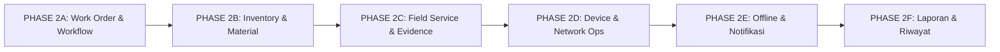

# DSBILLING STAFF — PHASE 2: OPERATIONAL MODULES & WORKFLOW INTEGRATION
## Roadmap Arsitektur, Pemetaan Fitur Existing & Rencana Eksekusi

Dokumen ini disusun sebagai cetak biru resmi (*blueprint*) untuk pelaksanaan **PHASE 2: Operational Modules & Workflow Integration** pada aplikasi **dsBilling Staff** (`D:\dsbilling-mobile`) dan backend **dsBilling** (`D:\dsBilling`).

---

## 1. Prinsip Fundamental Arsitektur

1. **Backend dsBilling adalah Single Source of Truth (SSOT)**:
   Aplikasi Android tidak menyimpan database lokal independen untuk Pelanggan, Stok Barang, Tiket, atau SPK. Seluruh data operasional divalidasi dan diotorisasi di backend Laravel dsBilling.
2. **Role & Permission Terpusat di Backend**:
   Otorisasi hak akses ditentukan oleh backend (`User::role`, `job_function`, `permissions`, `company_id`, `branch_id`). Aplikasi Android hanya bertindak sebagai antarmuka presentasi dinamis sesuai permission yang diberikan.
3. **GenieACS / TR-069 Terisolasi via Proxy Backend**:
   Tidak ada komunikasi langsung dari aplikasi Android ke port 7557 atau database MongoDB GenieACS. Seluruh perintah TR-069 wajib melalui controller proxy dsBilling (`MobileAcsProxyController`) dengan audit log.
4. **Audit Trail Mutlak**:
   Setiap transaksi material, penugasan teknisi, persetujuan admin/gudang, check-in GPS, hingga eksekusi TR-069 dicatat dengan stempel waktu, user ID, dan identitas branch.
5. **No Reinventing the Wheel**:
   Memanfaatkan dan menyempurnakan komponen Android Kotlin existing (`WorkOrdersBottomSheet`, `NetworkMapActivity`, `KeyStoreManager`, `GenieAcsNbiService`) serta relasi database Eloquent yang sudah ada di dsBilling.

---

## 2. Pemetaan Fitur Existing (Android vs Backend dsBilling)

| Domain Operasional | Status di Android (`D:\dsbilling-mobile`) | Status di Backend (`D:\dsBilling`) | Analisa Kesenjangan / Rencana Integrasi |
|---|---|---|---|
| **Autentikasi & Sesi** | • `LoginActivity.kt` (SSO Sanctum) • `KeyStoreManager.kt` (AES-256 GCM) • `AppPreferences.kt` | • `MobileAuthController.php` • Sanctum token revocation • Guard penolak Customer & Reseller | **Lengkap (Phase 1 Selesai)**. Token terenkripsi hardware Keystore, auto-logout saat expired. |
| **Work Order / SPK** | • `WorkOrdersBottomSheet.kt` • `WorkOrderAdapter.kt` • Filter chips: All, Pending, In Progress, Completed • Tombol Mulai & Selesai | • `MobileWorkforceApiController.php` (`workOrders`, `startWorkOrder`, `completeWorkOrder`) • Model: `WorkOrder`, `Ticket` • VULN-06 IDOR fix & branch scope | **Perlu Peningkatan (Phase 2A)**: Migrasi dari modal dialog ke Fragment/Screen penuh; penambahan estimasi jadwal, SLA, detail tiket gangguan, dan eskalasi. |
| **Inventory & Material** | • Input material sederhana di `WorkOrdersBottomSheet` (nama, jumlah, SN via dialog) • Model: `DsBillingMaterialUsage` | • Model: `InventoryItem`, `InventoryCustody`, `InventoryDispatch`, `InventoryRequisition`, `InventoryReturn`, `MaterialUsage` | **Kesenjangan Signifikan (Phase 2B)**: Di Android belum ada layar "Stok Teknisi", request material ke gudang, serah terima barcode, dan retur barang rusak/sisa. Di backend tabel sudah lengkap tinggal ekspos API. |
| **Bukti Pekerjaan & Lapangan** | • GPS Logger di background (`logGPS`) | • Endpoint `logGPS` • Model `GPSLog` • Relasi `WorkOrderChecklist` | **Perlu Peningkatan (Phase 2C)**: Perlu layar checklist dinamis, upload foto before/after dengan kompresi, input redaman ODP/ONT, dan modul tanda tangan digital pelanggan di layar sentuh. |
| **Diagnostik ONT & TR-069** | • `DeviceDetailActivity.kt` • Tab WAN, Wi-Fi, Status, Redaman RX/TX • Reboot & Summon ONT | • `MobileAcsProxyController.php` • Driver: `GenieACSDriver.php` • Proxy router ONT | **Fondasi Kuat (Phase 2D)**: TR-069 sudah diproxy dengan aman di Phase 1. Di Phase 2D ditambahkan pemindai QR/Barcode serial number ONT untuk otomatis mengisi formulir SPK pasang baru. |
| **GIS & Peta ODP** | • `NetworkMapActivity.kt` (OpenStreetMap / osmdroid) • Marker ODP & status redaman kabel | • Model `Odp.php` • Endpoint koordinat ODP & jalur kabel | **Siap Diintegrasikan**: Tampilkan rute dari lokasi teknisi saat ini ke ODP target SPK. |
| **Notifikasi & Sinkronisasi** | • Manual Pull-to-Refresh | • Laravel Notification system | **Perlu Dibangun (Phase 2E)**: Push notification Firebase/FCM untuk alert SPK baru, offline queue Room DB untuk menyimpan foto & progres saat sinyal blank spot. |
| **Riwayat & Laporan** | • Riwayat SPK lokal sederhana | • Tabel history & audit log dsBilling | **Perlu Dibangun (Phase 2F)**: Tab laporan produktivitas teknisi, pemakaian material bulanan, dan log aktivitas operasional. |

---

## 3. Matriks Hak Akses Berdasarkan Role

| Fitur Operasional | Administrator | Manager | NOC | Teknisi | Admin Gudang | CS | Kasir |
|---|:---:|:---:|:---:|:---:|:---:|:---:|:---:|
| **Dashboard Operasional** | View All | View All | View Network | View Tugas | View Stok | View Tiket | View Transaksi |
| **Daftar & Penugasan SPK** | Full Access | Assign & Approve | View Terkait | My SPK Only | View Material | View Status | No Access |
| **Eksekusi & Update SPK** | Full Access | Manage | No Access | Assigned SPK | No Access | No Access | No Access |
| **Stok Gudang (Master Stock)** | Full Access | View Only | No Access | No Access | Full Access | No Access | No Access |
| **Stok Teknisi (Custody)** | View All | View All | No Access | My Stock Only | Transfer & Terima | No Access | No Access |
| **Permintaan & Approval Material** | Approve | Approve | No Access | Request Only | Process & Dispatch | No Access | No Access |
| **Bukti Kerja, Checklist, Foto, TTD** | Review | Review | Review | Input/Upload | No Access | View Only | No Access |
| **Diagnostik ONT & TR-069 (Proxy)** | Full Access | Full Access | Full Access | Assigned ONT | No Access | View Only | No Access |
| **Peta ODP & Fiber GIS** | View All | View All | Full Access | View Assigned | No Access | View Lokasi | No Access |
| **Cek Tagihan & Status Pelanggan** | View All | View All | View Service | View Service | No Access | Full Access | Full Access |

---

## 4. Tahapan Rinci Eksekusi PHASE 2

Program **PHASE 2: Operational Modules & Workflow Integration** dipecah menjadi 6 subfase berurutan:

### PHASE 2A — Work Order & Operational Workflow
- **Backend**:
  - Endpoint `GET /api/mobile/work-orders` (filter status, priority, technician, date range).
  - Endpoint `GET /api/mobile/work-orders/{id}` (detail lengkap: pelanggan, paket layanan, tiket, checklist, ODP tujuan).
  - Endpoint `POST /api/mobile/work-orders/{id}/assign` (role manager/admin menugaskan teknisi).
  - Endpoint `POST /api/mobile/work-orders/{id}/status` (transisi status: `pending` -> `scheduled` -> `in_progress` -> `pending_approval` -> `completed` / `cancelled`).
- **Android**:
  - Upgrade antarmuka SPK dengan tab status terstruktur (*Pending*, *Berjalan*, *Menunggu Approval*, *Selesai*).
  - Tampilan detail SPK komprehensif (identitas pelanggan, paket internet, deskripsi keluhan/pekerjaan, navigasi maps).
  - Tombol aksi berbasis role (Teknisi: *Mulai Kerja*; Manager: *Tugaskan/Approve*).

### PHASE 2B — Inventory & Material Management
- **Backend**:
  - Endpoint `GET /api/mobile/inventory/my-stock` (daftar barang yang dipegang teknisi login dari `InventoryCustody`).
  - Endpoint `GET /api/mobile/inventory/items` (katalog barang gudang untuk request material).
  - Endpoint `POST /api/mobile/inventory/requisitions` (pengajuan permintaan barang oleh teknisi/reseller).
  - Endpoint `POST /api/mobile/inventory/requisitions/{id}/approve` (persetujuan gudang/manager).
  - Endpoint `POST /api/mobile/inventory/custody/transfer` (serah terima barang gudang ke teknisi atau antar-teknisi).
  - Endpoint `POST /api/mobile/inventory/returns` (pengembalian sisa material, ONT bekas/rusak, dan klaim hilang).
- **Android**:
  - Layar **"Stok Saya"** untuk teknisi (melihat sisa ONT, meteran kabel drop core, roset, fast connector).
  - Layar **"Katalog & Permintaan Barang"** untuk request stok ke gudang.
  - Form serah terima material dengan tanda terima digital.

### PHASE 2C — Field Service & Work Evidence
- **Backend**:
  - Endpoint `POST /api/mobile/work-orders/{id}/checklists/{checklistId}/toggle` (update checklist per item).
  - Endpoint `POST /api/mobile/work-orders/{id}/evidence` (upload foto before/after dengan kompresi backend, proteksi MIME type).
  - Endpoint `POST /api/mobile/work-orders/{id}/measurements` (simpan nilai redaman ODP dan redaman ONT dBm).
  - Endpoint `POST /api/mobile/work-orders/{id}/sign` (simpan tandatangan digital pelanggan base64/SVG).
- **Android**:
  - Komponen dinamis Checklist Instalasi/Perbaikan.
  - Modul Kamera & Galeri dengan watermark waktu, koordinat GPS, dan ID SPK otomatis.
  - Dialog Canvas Tanda Tangan Pelanggan di layar sentuh HP.
  - Input form hasil ukur optical power meter (OPM) redaman dBm.

### PHASE 2D — Device & Network Operations
- **Backend**:
  - Endpoint `POST /api/mobile/devices/provision-ont` (pairing serial number ONT hasil scan ke pelanggan dan port ODP).
  - Endpoint `GET /api/mobile/gis/odp-near` (daftar ODP terdekat berdasarkan koordinat GPS teknisi).
- **Android**:
  - Scanner QR Code / Barcode bawaan (ML Kit Barcode Scanning) untuk scan SN pada kardus/stiker ONT atau ONU.
  - Integrasi pencarian otomatis ONT di GenieACS setelah scan barcode.
  - Pintasan cepat diagnostik redaman optik langsung dari dalam kartu SPK.
  - Visualisasi rute teknisi ke ODP pada `NetworkMapActivity`.

### PHASE 2E — Notification, Offline & Synchronization
- **Backend**:
  - Event listener Work Order assignment & approval notification.
  - Endpoint `POST /api/mobile/sync/offline-batch` (menerima kumpulan data offline yang dikirim saat teknisi kembali dapat sinyal).
- **Android**:
  - Penyimpanan lokal Room Database / SQLite untuk caching data SPK dan stok saat offline.
  - Offline Job Queue untuk menampung checklist, pemakaian material, dan foto saat sinyal blank-spot.
  - Auto-sync worker yang otomatis jalan saat konektivitas pulih.

### PHASE 2F — Reporting & Operational History
- **Backend**:
  - Endpoint `GET /api/mobile/reports/technician-performance` (statistik SPK selesai, rata-rata durasi penyelesaian).
  - Endpoint `GET /api/mobile/reports/material-consumption` (rekap pemakaian barang per branch/teknisi).
- **Android**:
  - Tab dashboard analitik operasional sesuai role (Admin/Manager: performa tim; Teknisi: pencapaian pekerjaan bulan ini).

---

## 5. Keputusan & Kesiapan Eksekusi Subfase

Sesuai urutan dan arsitektur di atas:
- **Fondasi Phase 0 & Phase 1 sudah aman dan terverifikasi.**
- Pemetaan fitur telah jelas: **tidak ada duplikasi**, backend dsBilling menjadi Single Source of Truth (SSOT), dan setiap subfase memiliki batasan ruang lingkup yang tajam.
- Subfase pertama yang akan dieksekusi adalah **PHASE 2A: Work Order & Operational Workflow**.
