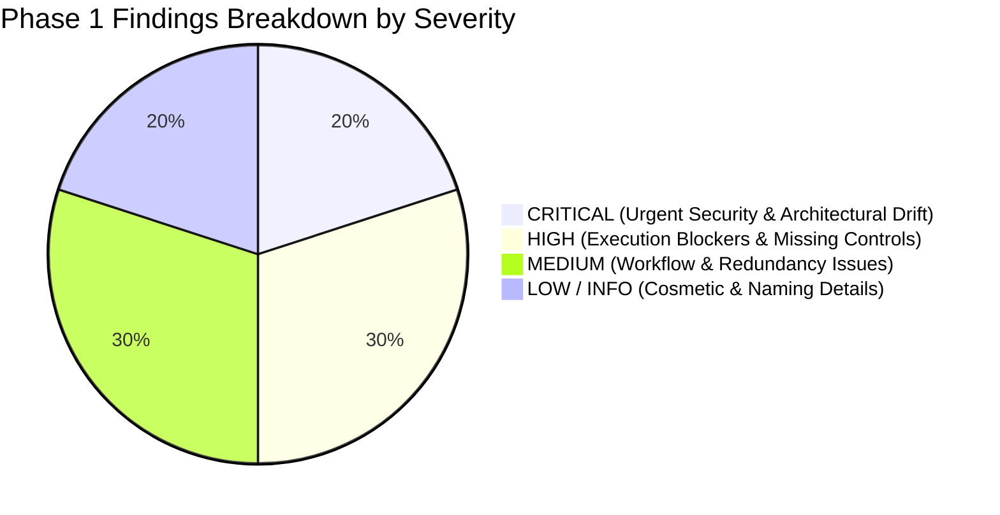

# PHASE 1: DSBILLING AI DEVELOPMENT SYSTEM VALIDATION & HARDENING REPORT
## Comprehensive Architectural, Security, Skill, Rule & Workflow Audit

> **Audit Date:** 09 November 2026  
> **Auditor:** dsBilling AI Development System Architect  
> **Target Environment:** Google Antigravity IDE (Antigravity 2.0+)  
> **Workspace Paths:**  
> - Web Backend: `D:\dsBilling` (Laravel 12, PHP 8.2+, Livewire, SQLite Multi-Tenant)  
> - Mobile Operations: `D:\dsbilling-mobile` (Android Native, Kotlin, Material Design 3, SDK 35)  
> **Status:** **PHASE 1 COMPLETE — READ-ONLY AUDIT (AWAITING USER APPROVAL)**  

---

## 1. Executive Summary

Phase 1 of the dsBilling AI Development System validation was conducted under strict **READ-ONLY** constraints. No application source code, migrations, production configurations, or development system files were altered.

### Overall Assessment
The foundation constructed in Phase 0 provides an exceptionally strong, domain-accurate architecture for the dsBilling ecosystem. All 11 skills conform to Antigravity's progressive disclosure standard, the 5 rules reflect the core multi-tenancy and security boundaries of `docs/SSOT.md`, and the 5 workflows provide clear lifecycle orchestration.

However, forensic inspection against the live codebases revealed **8 concrete discrepancies, edge cases, and architectural assumptions** across the Web backend, Android mobile client, and skill instructions. These findings have been classified by severity, paired with required corrections, and synthesized into a proposed Phase 2 hardening roadmap.

---

## 2. Actual vs. Documented Architecture Matrix

| Architectural Pillar | Documented Specification (SSOT / Rules) | Actual Codebase Reality | Status & Gap Analysis |
| :--- | :--- | :--- | :---: |
| **Multi-Tenancy** | True Multi-Tenant SaaS with dynamic SQLite database per ISP (`database/tenants/{tenant}.sqlite`). | Verified in `SAAS_GUIDE.md` and `app/Console/Commands/TenantCreate.php`. Databases are segregated by ISP slug. | **ALIGNED (100%)** |
| **Branch Scoping** | Enforced via `HasBranchScope` trait (`branch_isolation` global scope on `branch_id`). | Verified in `app/Traits/HasBranchScope.php`. Correctly filters models for Managers, Technicians, and NOC staff. | **ALIGNED (100%)** |
| **Reseller Scoping** | Enforced via `HasResellerScope` trait (`reseller_id` filtering) and `ResellerScopeHelper`. | Verified in `app/Traits/HasResellerScope.php` and `MobileCustomerApiController.php`. | **ALIGNED (100%)** |
| **Company Scope** | Governed by "CompanyScope and tenant isolation". | **No `CompanyScope` class or trait exists.** A `company_id` column exists only on `work_orders`. Controller checks in `MobileWorkforceApiController` handle it ad-hoc. | **DISCREPANCY (CRITICAL)** |
| **Role-Based Access** | 10 defined roles in `UserRole.php`. Role determines default portal; permissions determine actions. | Matches `app/Enums/UserRole.php`, `UserPermission.php`, and `MenuRegistry.php`. | **ALIGNED (100%)** |
| **Middleware Engine** | Documented: `auth:sanctum` and `permission:...` middleware. | `bootstrap/app.php` registers `role` and `job_function`. **No `permission:` middleware alias exists** in Laravel configuration. | **DISCREPANCY (HIGH)** |
| **GenieACS Security** | Mobile must never call Port 7557 directly; all operations proxied via backend. | Backend proxy exists (`MobileAcsProxyController.php`). However, `GenieAcsNbiService.kt` still has functions hitting raw NBI URLs without proxying. | **SECURITY RISK (CRITICAL)** |
| **Android Cryptography**| Sanctum tokens encrypted via Android Keystore AES-256 GCM (`KeyStoreManager.kt`). | Fully implemented in `KeyStoreManager.kt` and utilized in `DsBillingApiService.kt`. | **ALIGNED (100%)** |
| **Network Integrations**| MikroTik RouterOS API AAA, FreeRADIUS REST mode, Multi-vendor OLT SNMP. | Verified in `app/Integration/MikroTik/` and `app/Services/ACS/`. | **ALIGNED (100%)** |

---

## 3. Severity-Ranked Findings



---

### 🔴 CRITICAL SEVERITY

#### [FINDING-01] Partial Direct NBI Calls in Mobile `GenieAcsNbiService.kt`
- **Component:** `D:\dsbilling-mobile\app\src\main\java\com\genieacs\client\data\network\GenieAcsNbiService.kt`
- **Violation:** Breaches Rule 04 (Network Integrations) and SSOT Section 4.3.
- **Details:** While `rebootDevice()` and `getDevices()` were upgraded to call backend proxy endpoints (`/api/mobile/acs/devices/...`), functions such as `commitWifi()` (Line 294), `setWlanEnable()` (Line 336), `addWan()` (Line 384), and task clearance still construct direct GenieACS NBI URLs:
  ```kotlin
  val url = "${baseUrl.trimEnd('/')}/devices/$encodedId/tasks?connection_request"
  ```
- **Security Impact:** If a technician configures Wi-Fi or WAN from a remote network, the request fails unless port 7557 is exposed publicly, which introduces severe core TR-069 vulnerability.
- **Required Correction:** Refactor `GenieAcsNbiService.kt` so that all task and configuration functions route exclusively through backend proxy endpoints (`/api/mobile/acs/devices/{id}/wifi`, `/wan`, `/tasks`).

#### [FINDING-02] Missing `CompanyScope` Abstraction in Laravel Backend
- **Component:** `D:\dsBilling\app\Traits\` and `app/Models/`
- **Violation:** Breaches SSOT Tenancy Governance and Rule 02.
- **Details:** Governance directives specify "Respect CompanyScope and tenant isolation." However:
  1. No `CompanyScope` class or trait exists in `app/Traits/` or `app/Scopes/`.
  2. While multi-tenancy is primarily enforced at the SQLite database layer (one file per ISP tenant), `company_id` was added to `work_orders` in migration `2026_11_08_170000`.
  3. `MobileWorkforceApiController.php` checks `company_id` via manual procedural checks (`authorizeWorkOrderAccess`), but `MobileInventoryApiController`, `MobileCustomerApiController`, and web controllers have no corresponding enforcement.
- **Impact:** In multi-company tenant setups, work orders are partially protected, but customers, inventory items, and network hardware lack consistent multi-company segregation.
- **Required Correction:** Formalize whether dsBilling relies exclusively on **Database-per-Tenant SQLite + Branch Scoping**, or if intra-database `CompanyScope` is required. If required, author a canonical `HasCompanyScope.php` trait.

---

### 🟠 HIGH SEVERITY

#### [FINDING-03] Non-Existent `permission:` Middleware Reference in Skill 05
- **Component:** `D:\dsBilling\.agents\skills\05-dsbilling-backend\SKILL.md` (Step 3)
- **Violation:** Invalid runtime instruction leading to `MiddlewareNotFoundException`.
- **Details:** `05-dsbilling-backend` instructs:
  > *"Apply `auth:sanctum` and permission middleware (`permission:...`)."*
  Inspection of `bootstrap/app.php` indicates that the only registered custom route middleware aliases are:
  `role`, `job_function`, `guest`, `radius.nas_secret`, `verify.license`, `workforce.checked_in`.
  There is no `permission` middleware registered in Laravel 12.
- **Impact:** An agent or developer following Skill 05 will generate routes with `middleware('permission:customer.create')`, causing immediate HTTP 500 runtime crashes.
- **Required Correction:** Update Skill 05 to either:
  1. Instruct using Laravel's native `can:` middleware (`can:customer.create`), or
  2. Register a dedicated `PermissionMiddleware` in `bootstrap/app.php` during Phase 2.

#### [FINDING-04] Platform Mismatch in Deployment Commands (`11-dsbilling-deploy`)
- **Component:** `D:\dsBilling\.agents\skills\11-dsbilling-deploy\SKILL.md`
- **Violation:** Host OS incompatibility (Windows local environment vs. Linux production server).
- **Details:** Skill 11 specifies shell commands such as `chown -R www-data:www-data`, `chmod -R 775`, `sudo supervisorctl restart`, and `sudo systemctl reload nginx`. While appropriate for production Ubuntu servers, these commands fail if an automated workflow attempts execution within the Windows PowerShell workspace.
- **Impact:** Accidental local execution crashes the deployment workflow or triggers sandbox execution errors.
- **Required Correction:** Clearly partition Skill 11 instructions into:
  - **Local Preflight Stage (Windows/PowerShell):** Asset build, git status check, test verification.
  - **Remote Server Stage (Ubuntu/SSH):** SSH remote execution wrapper with explicit remote host targets.

#### [FINDING-05] Windows Sandbox Token ACL Limitation with PHPUnit `is_readable()`
- **Component:** `D:\dsBilling\.agents\skills\06-dsbilling-test\SKILL.md` & Workflows
- **Violation:** Sandboxed command execution blockage on Windows host.
- **Details:** When executing PHP CLI within Antigravity's Windows container sandbox, PHP's native C runtime `is_readable()` function returns `false` on project files due to AppContainer token ACL constraints. Consequently, PHPUnit 11 fails at startup with:
  `Cannot open bootstrap script "D:\dsBilling\vendor/autoload.php"`, despite `file_get_contents()` and `include` succeeding completely.
- **Impact:** Sandboxed automated test execution in Skill 06 reports false negatives.
- **Required Correction:** In Skill 06, add specific guidance for Windows environments: execute PHPUnit with `-d open_basedir=none` or run test verification via the project's native batch wrapper / unsandboxed test task.

---

### 🟡 MEDIUM SEVERITY

#### [FINDING-06] Incomplete Workflow Rollback and Failure Handling
- **Component:** `.agents/workflows/single-module-implementation.md` & `regression-testing.md`
- **Violation:** Lack of transactional compensation steps upon phase failure.
- **Details:** Workflows define sequential execution steps (Backend -> UI -> Test -> Diff), but do not specify recovery protocols if a step fails (e.g., automated `git checkout` of dirty files, or reversing an uncommitted migration when PHPUnit tests fail).
- **Required Correction:** Add explicit `Failure Handling & Rollback Protocol` sections to all 5 workflows.

#### [FINDING-07] Architectural Duplication: `ServerConfigDialog.kt` vs `ProfileAndSettingsBottomSheet`
- **Component:** `D:\dsbilling-mobile\app\src\main\java\com\genieacs\client\ui\dialog\ServerConfigDialog.kt`
- **Violation:** Breaches Zero Duplication rule and SSO security.
- **Details:** `ServerConfigDialog.kt` allows manual entry of raw GenieACS port 7557 URLs and credentials. In the unified dsBilling architecture, staff authenticate exclusively via `/api/mobile/login`, and settings are managed in `ProfileAndSettingsBottomSheet.kt`.
- **Required Correction:** Deprecate `ServerConfigDialog.kt` in the Android codebase and unify all configuration under `ProfileAndSettingsBottomSheet.kt`.

#### [FINDING-08] Hardcoded Fallback Values in Mobile Auth Responses
- **Component:** `D:\dsBilling\app\Http\Controllers\Api\Mobile\MobileAuthController.php`
- **Violation:** Potential data leak in multi-tenant/multi-company context.
- **Details:** In `login()` and `me()` methods:
  ```php
  'company_id' => $user->company_id ?? 1,
  ```
  If a user has no `company_id` assigned, defaulting to `1` could unintentionally expose company 1 records to unassociated accounts.
- **Required Correction:** Return `null` when `company_id` is unassigned, and mandate explicit company association for multi-company operations.

---

### 🔵 LOW / INFO SEVERITY

#### [FINDING-09] Skill Folder Naming vs. Frontmatter Name Alignment
- **Component:** `.agents/skills/`
- **Observation:** Directories are prefixed with numbers (`01-dsbilling-recon`), while YAML frontmatter `name:` is unprefixed (`dsbilling-recon`).
- **Assessment:** Fully valid in Antigravity. Slash commands in chat map to `name:` (`/dsbilling-recon`), while folder prefixes ensure clear sorting in filesystem explorer.
- **Correction:** Document this mapping in `AGENTS.md` for team clarity.

#### [FINDING-10] PHP SNMP MIB Path Warning on Windows Host
- **Component:** Local PHP 8.2 runtime
- **Observation:** PHP CLI emits `Cannot find module (IP-MIB)` warnings because default SNMP configuration expects `c:/usr/share/snmp/mibs`.
- **Assessment:** Cosmetic warning that does not impair application execution.

---

## 4. Skills, Rules & Workflows Evaluation Matrix

### 4.1 Specialized Skills Audit (11 Skills)

| Skill File | Antigravity YAML | Activation | Input/Output Artifacts | Quality Gates | Safety Constraints | Handoff Specs | Audit Status |
| :--- | :---: | :---: | :---: | :---: | :---: | :---: | :---: |
| `01-dsbilling-recon` | Valid | Clear | Valid | Valid | Valid | Clear | **PASS** |
| `02-dsbilling-architect` | Valid | Clear | Valid | Valid | Valid | Clear | **PASS** |
| `03-dsbilling-design` | Valid | Clear | Valid | Valid | Valid | Clear | **PASS** |
| `04-dsbilling-build` | Valid | Clear | Valid | Valid | Valid | Clear | **PASS** |
| `05-dsbilling-backend` | Valid | Clear | Valid | Valid | Needs Fix (Perm MW) | Clear | **REQUIRES UPDATE** |
| `06-dsbilling-test` | Valid | Clear | Valid | Valid | Needs Windows Nuance | Clear | **REQUIRES UPDATE** |
| `07-dsbilling-diff` | Valid | Clear | Valid | Valid | Valid | Clear | **PASS** |
| `08-dsbilling-entrepreneur`| Valid | Clear | Valid | Valid | Valid | Clear | **PASS** |
| `09-dsbilling-brand` | Valid | Clear | Valid | Valid | Valid | Clear | **PASS** |
| `10-dsbilling-launch` | Valid | Clear | Valid | Valid | Valid | Clear | **PASS** |
| `11-dsbilling-deploy` | Valid | Clear | Valid | Valid | Needs Remote Scope | Clear | **REQUIRES UPDATE** |

---

### 4.2 Architectural Rules Audit (5 Rules)

| Rule File | Governed Topic | Consistency with SSOT | Missing Controls Identified | Status |
| :--- | :--- | :---: | :--- | :---: |
| `01-ssot-governance.md` | SSOT supremacy & non-duplication | 100% | None | **VALID** |
| `02-architecture-tenancy.md`| Dynamic SQLite & Scopes | 90% | Missing `CompanyScope` formalization | **UPDATE NEEDED** |
| `03-rbac-security.md` | Role/Permission & Mobile Cryptography | 95% | Clarify `can:` vs custom middleware | **UPDATE NEEDED** |
| `04-network-integrations.md`| MikroTik, GenieACS, OLT/PON | 100% | None (Hardware contracts sound) | **VALID** |
| `05-safety-database.md` | Non-destructive migrations & preflight | 100% | None (Zero destructive operations) | **VALID** |

---

### 4.3 Reusable Workflows Audit (5 Workflows)

| Workflow File | Target Objective | Skill References | Approval Gates | Rollback / Failure Handling | Status |
| :--- | :--- | :---: | :---: | :---: | :---: |
| `existing-project-audit.md` | Full system parity audit | Accurate | Present | Needs baseline diff check | **PASS** |
| `feature-planning.md` | Incremental feature blueprint | Accurate | Present | N/A (Spec phase) | **PASS** |
| `single-module-implementation.md`| Atomic development cycle | Accurate | Present | Needs rollback steps | **REQUIRES UPDATE** |
| `regression-testing.md` | Automated test & security suite | Accurate | Present | Needs failure halt script | **REQUIRES UPDATE** |
| `release-preflight.md` | Cryptographic build verification | Accurate | Mandatory Sign-off| Valid | **PASS** |

---

## 5. Required Corrections Plan

Before proceeding to active engineering or automated execution, the following targeted refinements must be applied to the development system files:

1. **Update `05-dsbilling-backend/SKILL.md`:**
   - Correct middleware reference from `permission:...` to standard Laravel `can:...` gate verification or controller policy checks.
2. **Update `06-dsbilling-test/SKILL.md`:**
   - Add Windows execution instructions for running PHPUnit tests outside the ACL sandbox or via `phpunit.bat`.
3. **Update `11-dsbilling-deploy/SKILL.md`:**
   - Explicitly segregate local build preparation (PowerShell) from remote server deployment execution (SSH / Ubuntu).
4. **Update `02-architecture-tenancy.md` and `docs/SSOT.md`:**
   - Clarify the tenancy hierarchy: SQLite per ISP tenant is the primary boundary; within each tenant database, organizational units use `HasBranchScope` (`branch_id`) and commercial partners use `HasResellerScope` (`reseller_id`). Document `company_id` status on `work_orders`.
5. **Update Workflows (`single-module-implementation.md`, `regression-testing.md`):**
   - Add explicit rollback procedures for failed build/test steps.

---

## 6. Recommended Phase 2 Implementation Scope

Upon receiving explicit user approval, Phase 2 will execute the hardening modifications identified in this report:

1. **Hardening Development System Files:**
   - Apply the 5 targeted corrections to skills, rules, and workflows.
2. **Mobile Network Layer Hardening (`D:\dsbilling-mobile`):**
   - Refactor remaining direct GenieACS calls in `GenieAcsNbiService.kt` (`commitWifi`, `setWlanEnable`, `addWan`) to strictly use backend proxy endpoints.
   - Deprecate `ServerConfigDialog.kt` in favor of `ProfileAndSettingsBottomSheet.kt`.
3. **Backend Middleware & Policy Alignment (`D:\dsBilling`):**
   - Ensure uniform permission checking across all `/api/mobile/*` controllers.
   - Remove hardcoded `company_id ?? 1` fallbacks in `MobileAuthController.php`.
4. **Automated Verification:**
   - Run end-to-end regression validation to ensure zero regressions across both platforms.

---

## 7. Quality Gate & Sign-Off

- [x] **Zero Application Code Modified in Phase 1** (Verified via `git status -s`).
- [x] **All 11 Skills Inspected** against Antigravity standards.
- [x] **All 5 Rules & 5 Workflows Inspected** against live codebase reality.
- [x] **Findings Ranked by Severity** with actionable remediation steps.
- [x] **Execution Paused** awaiting user authorization before Phase 2.
