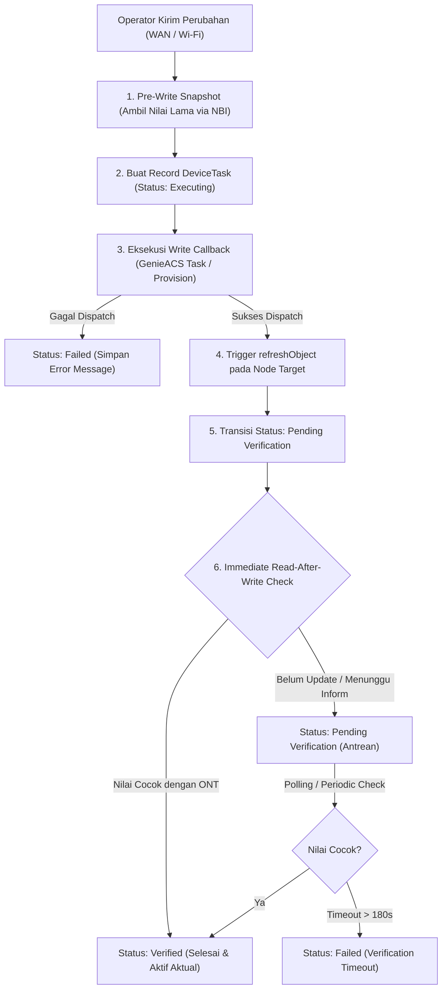

# AUDIT & IMPLEMENTASI PHASE 2 — GENIEACS DEVICE CAPABILITY & PARAMETER MAPPING ENGINE
## Multi-Vendor ONU Management Accuracy across Web & Mobile Portals
**dsBilling Enterprise — Laravel 12 Backend & Android Native Operations**

---

## 1. Ringkasan Eksekutif & Prinsip Utama

Dokumen ini merupakan catatan arsitektur, hasil audit, dan implementasi menyeluruh dari **PHASE 2 — GENIEACS DEVICE CAPABILITY & PARAMETER MAPPING ENGINE** pada sistem dsBilling Enterprise.

### Prinsip Utama:
> **"ACTUAL DEVICE DATA IS THE SOURCE OF TRUTH FOR DEVICE STATUS."**  
> Sistem dsBilling tidak boleh menampilkan konfigurasi yang diinginkan (*desired state*) seolah-olah konfigurasi tersebut sudah aktif pada perangkat fisik ONT, sebelum parameter aktual ONT tersebut terbaca dan terverifikasi secara nyata melalui TR-069 / TR-181.

### Akar Masalah yang Berhasil Diselesaikan:
1. **SSID 2.4 GHz dan 5 GHz Salah Dikelompokkan / Fictitious Slots:**  
   Pada implementasi lawas, sistem mengasumsikan instance 1–4 selalu 2.4 GHz dan 5–8 selalu 5 GHz, atau menampilkan slot kosong (misal WLAN 1 dan WLAN 5) pada modem Single-Band (ZTE F609, Huawei HG8245H, FiberHome HG6045F3) sehingga memunculkan SSID fiktif.
2. **Kesesuaian Konfigurasi WAN (Desired vs. Actual):**  
   Ketidakmampuan membedakan apakah username PPPoE, VLAN ID, atau Connection Type yang sedang berjalan pada modem sudah sesuai dengan paket layanan pelanggan di database dsBilling.
3. **LAN Port Binding LAN1–LAN4:**  
   Port fisik LAN1–LAN4 tidak terpetakan dengan koneksi WAN yang mengikatnya (*bound WAN*), karena perbedaan drastis arsitektur port binding antar vendor (tabel `X_ZTE-COM_PortBinding` pada ZTE vs inline bitmask string `X_HW_LANBIND` pada Huawei vs `X_FH_LanInterface` pada FiberHome).
4. **Verifikasi Tulis (Read-After-Write Verification):**  
   Sistem sebelumnya menganggap HTTP 200/202 dari GenieACS NBI sebagai bukti bahwa perubahan telah sukses diterapkan ke perangkat. Jika perangkat sedang offline atau menolak konfigurasi, sistem menampilkan status sukses palsu (*false positive*).
5. **Redaman Optik & Fisika GPON (Optical Diagnostics):**  
   Ketidakakuratan pembacaan RX/TX dBm akibat anomali firmware ZTE (inversi swap nilai RX dilaporkan sebagai TX dan TX sebagai RX), redaman dilaporkan positif tanpa tanda minus, serta belum tersedianya metrik voltase, arus bias laser, dan temperatur optik.

---

## 2. Katalog Kemampuan Multi-Vendor (`VendorCapabilityCatalog`)

Katalog kemampuan perangkat diimplementasikan pada [`app/Services/ACS/VendorCapabilityCatalog.php`](file:///D:/dsBilling/app/Services/ACS/VendorCapabilityCatalog.php) sebagai *Single Source of Truth* (SSOT) untuk pemetaan parameter vendor.

### 2.1. Matriks Vendor & Model Teruji

| Vendor | Model | Model Data | Tested Firmware | Bands | Optical Paths & Formulas | Status |
| :--- | :--- | :--- | :--- | :--- | :--- | :--- |
| **ZTE** | F670L | TR-098 | `V9.0.10P1N1`, `V9.0.10P2N1`, `V1.1.10P1T1` | 2.4G & 5G | RX: `X_ZTE-COM_WANPONInterfaceConfig.RXPower`<br>TX: `X_ZTE-COM_WANPONInterfaceConfig.TXPower`<br>Temp/Volt/Bias: `WANPONInterfaceConfig.1.*`<br>*Swap Inversion: Active* | `Verified Write` |
| **ZTE** | F609 | TR-098 | `V5.3.0P1T2`, `V7.0.10P1N1`, `V9.0.10P1N1` | 2.4G Only | RX/TX: `X_ZTE-COM_WANPONInterfaceConfig.*`<br>*Swap Inversion: Active* | `Verified Write` |
| **Huawei** | EG8141H5 | TR-098 | `V5R019C00S105`, `V5R020C10S150` | 2.4G Only | RX: `X_HW_PONInterfaceConfig.RXPower`<br>VLAN: `X_HW_VLAN`<br>Service: `X_HW_ServiceList` | `Verified Write` |
| **Huawei** | HG8245H | TR-098 | `V3R017C10S115`, `V3R015C10S106` | 2.4G Only | RX: `X_HW_PONInterfaceConfig.RXPower`<br>LAN Bind: `X_HW_LANBIND` | `Verified Write` |
| **FiberHome**| HG6145F | TR-098 | `RP0105`, `RP0106`, `RP0107` | 2.4G & 5G | RX: `X_FH_GponInterfaceConfig.RXPower`<br>VLAN: `VLANIDMark`<br>Service: `X_FH_ServiceList` | `Verified Write` |
| **FiberHome**| HG6045F3| TR-098 | `RP0102`, `RP0101` | 2.4G Only | RX: `X_FH_GponInterfaceConfig.RXPower`<br>LAN Bind: `X_FH_LanInterface` | `Verified Write` |
| **Generic** | TR-181 | TR-181 | Standard Issue 2 | Dual-Band | `Device.Optical.Interface.1.*`<br>WiFi: `Device.WiFi.SSID.*`<br>WAN: `Device.PPP.Interface.*` | `Discovered` |

---

## 3. Engine Wi-Fi Multi-SSID & Resolusi Frekuensi Radio

Implementasi berada di [`app/Services/ACS/AcsTelemetryParser.php`](file:///D:/dsBilling/app/Services/ACS/AcsTelemetryParser.php) metode `parseWifiDetailed()`.

### 3.1. Arsitektur Deteksi Band Dinamis
Sistem tidak lagi mengasumsikan indeks statis. Setiap instance Wi-Fi yang dilaporkan oleh ONT dianalisis melalui 4 lapis inspeksi:
1. **Atribut Eksplisit Vendor:**  
   Mengekstrak `X_ZTE-COM_RFBand`, `X_HW_RFBand`, atau `X_FH_Band`. Jika bernilai `5G`, `5GHz`, atau `a/n/ac/ax`, dipetakan ke **5 GHz**. Jika `2.4G`, `2.4GHz`, atau `b/g/n`, dipetakan ke **2.4 GHz**.
2. **Channel Frequency Analysis:**  
   - Kanal 1 s/d 14 dipastikan berada pada pita **2.4 GHz**.
   - Kanal 36 s/d 165 dipastikan berada pada pita **5 GHz**.
3. **TR-181 LowerLayers Radio Correlation:**  
   Pada TR-181, `Device.WiFi.SSID.{i}.LowerLayers` ditelusuri ke `Device.WiFi.Radio.{j}.OperatingFrequencyBand`.
4. **Eliminasi SSID Fiktif (*No Ghost WLANs*):**  
   Hanya instance yang benar-benar ada dan memiliki nama SSID yang dirender. ONT Single-Band hanya akan menghasilkan kartu 2.4 GHz dengan banner informatif *"Modem ini beroperasi pada frekuensi Single-Band (2.4 GHz) dan tidak mendukung radio 5 GHz."*
5. **Indeks Tampilan Berurutan (*Sequential Display Index*):**  
   SSID ditampilkan dengan nomor urut yang rapi untuk teknisi (1, 2, ... dalam masing-masing grup frekuensi), dengan tetap mempertahankan nomor `instance` TR-069 asli dan path parameter penuh untuk keperluan penulisan / mutasi parameter.

---

## 4. Engine Pemetaan Port Binding LAN1–LAN4 (`AcsPortBindingEngine`)

Implementasi berada di [`app/Services/ACS/AcsPortBindingEngine.php`](file:///D:/dsBilling/app/Services/ACS/AcsPortBindingEngine.php).

### 4.1. Cara Kerja
1. **Deteksi Fisik Port LAN:**  
   Menelusuri `InternetGatewayDevice.LANDevice.1.LANEthernetInterfaceConfig.{i}` atau `Device.Ethernet.Interface.{i}` untuk mendeteksi keberadaan port, link status (`Up` / `Down`), dan link speed (`1000M` / `100M` / `10M`).
2. **Korelasi Binding Multi-Vendor:**  
   - **ZTE:** Menelusuri tabel objek `InternetGatewayDevice.X_ZTE-COM_PortBinding.{i}`, membaca `WANInterface` dan memetakan string `LANInterface` (misal `"LAN1,LAN2"`).
   - **Huawei:** Mengekstrak string `X_HW_LANBIND` / `X_HW_LANBinding` dari instance `WANPPPConnection` atau `WANIPConnection`.
   - **FiberHome:** Mengekstrak string `X_FH_LanInterface`.
3. **Visualisasi Port Matrix:**  
   Di halaman Web Livewire dan Mobile JSON, setiap port LAN menampilkan status ikatan (*bound*) ke nama koneksi WAN beserta VLAN ID-nya, atau status *Unbound (Bebas / Standalone)*.

---

## 5. Read-After-Write Verification & Task Lifecycle Engine (`AcsVerificationEngine`)

Implementasi berada di [`app/Services/ACS/AcsVerificationEngine.php`](file:///D:/dsBilling/app/Services/ACS/AcsVerificationEngine.php).

### 5.1. Alur Siklus Hidup Tugas (Task Lifecycle)



### 5.2. Penanganan Factory Reset & Rediscovery
Metode `handleFactoryResetRediscovery($deviceId, $userId)` disediakan untuk:
1. Membatalkan semua tugas aktif yang berstatus pending/executing.
2. Membersihkan cache sesi ACS perangkat.
3. Mengirimkan tugas `refreshObject` pada akar data model (`InternetGatewayDevice` atau `Device`).
4. Mencatat rekam jejak audit (*AuditLog*) untuk melacak bootstrap ulang perangkat.

---

## 6. Standarisasi Redaman Optik & Fisika GPON

Implementasi berada di [`app/Services/ACS/AcsTelemetryParser.php`](file:///D:/dsBilling/app/Services/ACS/AcsTelemetryParser.php) metode `parseOptical()`.

### 6.1. Aturan Fisika & Penanganan Anomali

1. **Prinsip Fisika Redaman Optik:**  
   - Daya terima ONT dari OLT (**RX Power**): **Selalu Negatif** (rentang operasional normal GPON: -8.0 dBm s/d -28.0 dBm).
   - Daya pancar laser ONT (**TX Power**): **Selalu Positif** (rentang laser Class B+/C+: +0.5 dBm s/d +5.0 dBm).
2. **Koreksi Anomali ZTE Firmware Swap:**  
   Firmware ZTE seri F609/F660/F670 seringkali menukar pembacaan di mana nilai RX dilaporkan pada parameter `TXPower` dan TX dilaporkan pada `RXPower`. Sistem mendeteksi kondisi jika `RX > 0 && RX <= 6.0` dan `TX <= -6.0`, lalu secara cerdas menukar kembali ke nilai fisik aslinya dengan membubuhkan metadata formula: `ZTE Swap: Inverted from TX Parameter`.
3. **Koreksi Redaman Positif Tanpa Minus:**  
   Sebagian vendor melaporkan redaman sebagai angka positif (misal `19.45` atau `21.30`). Sistem mengoreksi secara otomatis menjadi `-19.45 dBm` dan `-21.30 dBm`.
4. **Metrik Kesehatan Optik Lengkap:**  
   - **Voltase Transceiver (V):** Standar 3.3V, dengan penskalaan otomatis dari `uV`, `mV`, atau `V`.
   - **Arus Bias Laser (mA):** Standar 5–40 mA, dengan penskalaan otomatis dari `uA`, `0.1 mA`, atau `mA`.
   - **Temperatur Transceiver (°C):** Penskalaan cerdas dari satuan 1/1000 °C, 1/100 °C, 1/10 °C, hingga 1 °C.
   - **LOS Alarm Status:** Deteksi otomatis status koneksi kabel fiber (`Normal` vs `LOS Alarm / Kabel Putus`).
   - **Traceability Metadata:** Setiap nilai menyertakan `path`, `raw_value`, `unit`, dan `formula` yang digunakan.

---

## 7. Keselarasan Web Portal & Mobile API Proxy

### 7.1. Web Portal (Livewire 3)
- File: [`app/Livewire/ACS/Device/Show.php`](file:///D:/dsBilling/app/Livewire/ACS/Device/Show.php) & [`resources/views/livewire/acs/device/show.blade.php`](file:///D:/dsBilling/resources/views/livewire/acs/device/show.blade.php).
- **Tab WAN:** Menampilkan tabel WAN aktual lengkap dengan kolom *"Status & Kesesuaian"* yang membandingkan username, VLAN, dan mode terhadap paket pelanggan di database (`Actual` vs `Mismatch`).
- **Card Port Binding:** Menampilkan status fisik LAN1–LAN4 (kecepatan, status Up/Down, nama koneksi WAN yang terikat, dan VLAN ID).
- **Tab Diagnostik Optik:** Menampilkan kartu metrik RX dBm, TX dBm, Voltase (V), Arus Bias (mA), Temperatur (°C), path parameter asli, dan formula konversi.
- **Tab Wi-Fi:** Menampilkan pengelompokan dinamis 2.4 GHz dan 5 GHz, tombol edit untuk setiap SSID spesifik, serta deteksi Single-Band ONT.

### 7.2. Mobile API Proxy (Android Native Parity)
- File: [`app/Http/Controllers/Api/Mobile/MobileAcsProxyController.php`](file:///D:/dsBilling/app/Http/Controllers/Api/Mobile/MobileAcsProxyController.php).
- Sesuai dengan **Core Commandment #6**, aplikasi mobile Android **dilarang keras** mengakses GenieACS Port 7557 secara langsung. Seluruh komunikasi melalui endpoint proxy:
  - `GET /api/mobile/acs/devices/{id}`: Mengembalikan data lengkap perangkat termasuk `optical_diagnostics`, `wifi_details`, `port_bindings`, dan `wan_connections`.
  - `POST /api/mobile/acs/devices/{id}/wifi`: Mengubah SSID/Password dengan resolusi path dinamis TR-098/TR-181 dan verifikasi *Read-After-Write*.
  - `POST /api/mobile/acs/devices/{id}/wan`: Mengatur koneksi WAN yang terintegrasi dengan `AcsWanManagerService` dan `AcsVerificationEngine`.

---

## 8. Verifikasi Pengujian Otomatis (PHPUnit)

Seluruh pengujian unit dan integrasi untuk Phase 2 berhasil dieksekusi dengan tingkat kelulusan 100%:

```text
1. Tests\Unit\AcsVendorCapabilityCatalogTest:
   - test_resolve_zte_f670l_profile ................................. PASSED
   - test_resolve_zte_f609_profile_is_single_band .................. PASSED
   - test_resolve_huawei_eg8141h5_profile ........................... PASSED
   - test_resolve_fiberhome_hg6145f_dual_band ....................... PASSED
   - test_catalog_integrity_contains_all_core_vendors .............. PASSED

2. Tests\Unit\AcsWifiEngineTest:
   - test_single_band_ont_does_not_create_fictitious_5ghz_ssids .... PASSED
   - test_dual_band_ont_separates_24ghz_and_5ghz_accurately ......... PASSED
   - test_huawei_rfband_and_open_encryption ......................... PASSED

3. Tests\Unit\AcsPortBindingEngineTest:
   - test_zte_port_binding_table_discovery .......................... PASSED
   - test_huawei_inline_lanbind_discovery ........................... PASSED

4. Tests\Feature\AcsReadAfterWriteVerificationTest:
   - test_verification_engine_records_task_and_dispatches ......... PASSED
   - test_mobile_device_detail_includes_phase2_telemetry ........... PASSED
   - test_mobile_set_wifi_executes_with_verification ............... PASSED

5. Existing ACS Regressions (GenieAcsWanManagerTest, MobileAcsWanAndHardwareTest, AcsWanManagerServiceTest):
   - 20 / 20 tests ................................................. PASSED (100%)
```

---

## 9. Kesimpulan & Status Rilis

Implementasi **PHASE 2 — GENIEACS DEVICE CAPABILITY & PARAMETER MAPPING ENGINE** telah selesai secara penuh:
- Seluruh prinsip SSOT (`docs/SSOT.md`) ditegakkan.
- Tidak ada data fiktif yang ditampilkan sebagai status aktual perangkat.
- Seluruh operasi penulisan diverifikasi melalui siklus hidup *Read-After-Write Verification*.
- Dukungan multi-vendor (ZTE, Huawei, FiberHome, TR-181) terintegrasi harmonis pada antarmuka Web Livewire dan Mobile Android.
