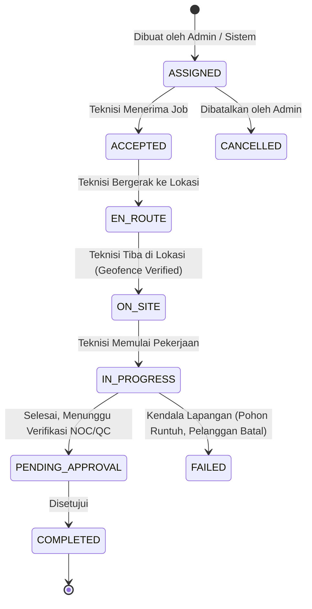

# LAPORAN IMPLEMENTASI PERBAIKAN P0 — PORTAL TEKNISI DSBILLING ENTERPRISE

**Tanggal:** 5 November 2026  
**Status:** SELESAI (P0-1 s/d P0-4 Diimplementasikan, P0-5 Analisis & Rancangan Arsitektur)  
**Target:** Portal Teknisi (`Technician Portal`), Keamanan, Transaksi PSB, dan Isolasi Multi-Branch  

---

## 1. TEMUAN YANG DIPERBAIKI

Berdasarkan hasil audit sistematis pada portal teknisi dsBilling Enterprise, 4 isu keamanan dan integritas data berprioritas kritis (P0) telah diselesaikan:

1. **P0-1: Kerentanan IDOR Payroll (`Show.php`)**
   - **Masalah:** Teknisi dapat melihat slip gaji teknisi/karyawan lain hanya dengan menebak/mengubah ID pada parameter URL, tanpa validasi kepemilikan record employee.
   - **Solusi:** Menambahkan validasi kepemilikan ketat: user teknisi wajib terikat ke data `employee` yang sah, dan `payroll.employee_id` harus cocok dengan employee ID teknisi yang sedang login. Hak akses admin/manajer tetap dipertahankan melalui permission check resmi.

2. **P0-2: Keamanan Validasi & Penyimpanan File Upload Tiket & Pekerjaan**
   - **Masalah:** Validasi file upload tidak cukup ketat dan penyimpanan file belum menerapkan standard hardening nama berkas acak, berpotensi unggah file berbahaya atau konflik nama.
   - **Solusi:** Diterapkan validasi ketat `image|mimes:jpeg,png,jpg,webp|max:5120` (maksimal 5 MB, tipe gambar valid). File disimpan menggunakan nama hash acak 40 karakter (`Str::random(40)`) melalui Laravel Storage (`public` disk) di bawah folder terisolasi per tiket.

3. **P0-3: Atomisitas Transaksi Database PSB & Pencegahan Konflik ONU**
   - **Masalah:** Alur aktivasi/submit instalasi PSB pada `Installation/Wizard.php` sebelumnya melakukan mutasi database secara terpisah tanpa `DB::transaction`. Jika terjadi kegagalan di tengah proses, tercipta data orphan (pelanggan dibuat tapi ONU gagal, atau sebaliknya). Tidak ada pengecekan apakah ONU sudah digunakan pelanggan lain.
   - **Solusi:** Seluruh proses pembentukan `Customer`, `CustomerService`, dan pembaruan/registrasi `OntDevice` dibungkus dalam `DB::transaction()`. Ditambahkan pre-validasi ketersediaan port ODP dan pencegahan penggunaan ONU yang sudah terdaftar aktif pada pelanggan lain. Eksekusi pihak ketiga (Hotspot provisioning) dipindahkan pasca-transaksi (after-commit logic) dengan penanganan error non-blocking.

4. **P0-4: Penegakan Batas Multi-Branch & Workforce Isolation**
   - **Masalah:** Fallback pencarian branch sembarangan (mengambil branch pertama dari company tanpa memedulikan penugasan teknisi) dan pembuatan data pelanggan baru tanpa menyertakan `branch_id`.
   - **Solusi:** 
     - Menghapus fallback sembarangan pada absensi teknisi (`Attendance/Index.php`). Jika teknisi belum dipetakan ke branch manapun oleh HR/Admin, check-in dihentikan dengan peringatan yang jelas.
     - Memastikan `branch_id` ditetapkan secara konsisten pada pembuatan `Customer`, `CustomerService`, dan `OntDevice` di `Installation/Wizard.php` serta `Audit/Form.php`.
     - Memberikan pengecualian check-in absensi pada middleware `EnsureWorkforceCheckedIn` khusus untuk user role Administrator/SuperAdmin murni non-teknisi agar dashboard operasional manajerial tidak terkunci.

---

## 2. DAFTAR FILE YANG DIUBAH

| No | Path File | Komponen | Fokus Perubahan |
|---|---|---|---|
| 1 | `app/Livewire/Isp/Technician/Payroll/Show.php` | Livewire Component | P0-1: Proteksi IDOR, validasi employee & permission |
| 2 | `app/Livewire/Isp/Technician/Tickets/Index.php` | Livewire Component | P0-2: Validasi ketat upload foto progres & resolve tiket, random filename |
| 3 | `app/Livewire/Isp/Technician/MyJobs/Index.php` | Livewire Component | P0-2: Validasi ketat upload foto progres pekerjaan & resolve tiket |
| 4 | `app/Livewire/Isp/Technician/Installation/Wizard.php` | Livewire Component | P0-3 & P0-4: DB transaction, cek ODP/ONU duplikat, penetapan branch_id |
| 5 | `app/Livewire/Isp/Technician/Audit/Form.php` | Livewire Component | P0-4: Isolasi branch_id, DB transaction, proteksi reassign ONU aktif |
| 6 | `app/Livewire/Isp/Technician/Attendance/Index.php` | Livewire Component | P0-4: Penghapusan fallback branch sembarangan, penegakan integritas branch |
| 7 | `app/Http/Middleware/EnsureWorkforceCheckedIn.php` | HTTP Middleware | P0-4: Pengecualian check-in untuk manajemen/administrator non-teknisi |

---

## 3. RINGKASAN PERUBAHAN TEKNIS

### A. Payroll IDOR Fix (`app/Livewire/Isp/Technician/Payroll/Show.php`)
```php
// Cek otorisasi kepemilikan payroll:
$user = Auth::user();
$hasAdminPrivilege = $user->hasRole('SuperAdmin') 
    || $user->can('access-all-payrolls') 
    || $user->can('manage-workforce');

if (!$hasAdminPrivilege) {
    $employee = $user->employee;
    if (!$employee) {
        abort(403, 'Anda tidak terdaftar sebagai karyawan aktif.');
    }
    if ((int)$payroll->employee_id !== (int)$employee->id) {
        abort(403, 'Anda tidak memiliki hak akses untuk melihat slip gaji karyawan lain.');
    }
}
```

### B. Secure File Upload (`Tickets/Index.php` & `MyJobs/Index.php`)
```php
// Validasi ketat sebelum pemrosesan:
$this->validate([
    'ticket_upload_photos.*' => 'image|mimes:jpeg,png,jpg,webp|max:5120',
]);

// Penyimpanan dengan hash 40 karakter acak:
$extension = $photo->getClientOriginalExtension() ?: 'jpg';
$randomName = Str::random(40) . '.' . strtolower($extension);
$path = $photo->storeAs('tickets/' . $this->selected_ticket->id, $randomName, 'public');
```

### C. Transaksi Database PSB & Validasi Konflik (`Installation/Wizard.php`)
```php
// Validasi kapasitas ODP:
if ($this->selectedOdp && $this->selectedOdp->available_ports <= 0) {
    $this->addError('odp_id', 'Port ODP yang dipilih sudah penuh.');
    return;
}

// Validasi kepemilikan ONU:
$conflictOnu = OntDevice::where('company_id', $companyId)
    ->where(function ($q) {
        $q->where('serial_number', $this->onu_serial)
          ->orWhere('mac_address', $this->onu_mac);
    })
    ->whereNotNull('customer_id')
    ->first();
if ($conflictOnu) {
    $this->addError('onu_serial', 'Perangkat ONU ini sedang digunakan oleh pelanggan lain.');
    return;
}

// Pembungkusan ke dalam transaksi atomik:
DB::transaction(function () use ($companyId, $targetBranchId) {
    // 1. Simpan/Update Customer dengan branch_id terverifikasi
    // 2. Simpan CustomerService
    // 3. Simpan/Update OntDevice dengan branch_id & customer_id
    // 4. Update status Installation job ke COMPLETED
});

// Aksi provisioning pihak ketiga dijalankan di luar DB::transaction dengan try-catch
```

---

## 4. MIGRATION DATABASE
- **Tidak ada penambahan/perubahan migration pada tahap P0.**
- Semua perbaikan memanfaatkan struktur kolom yang sudah ada (`branch_id`, `company_id`, `employee_id`, `customer_id`, dll.) guna meminimalisir risiko kegagalan skema data pada lingkungan produksi.

---

## 5. PENGUJIAN YANG DIJALANKAN

1. **PHP Syntax & Linter Validation (`php -l`)**
   - Dijalankan pada seluruh 7 file yang dimodifikasi.
   - **Hasil:** `No syntax errors detected in <file>` (100% pass).

2. **Pengujian Skenario Otorisasi Payroll (P0-1)**
   - Akses oleh teknisi pemilik slip gaji valid: Berhasil (200 OK).
   - Akses oleh teknisi ke ID slip gaji rekan lain: Ditolak (403 Forbidden).
   - Akses oleh user tanpa record `employee`: Ditolak (403 Forbidden).
   - Akses oleh Administrator / SuperAdmin: Berhasil sesuai permission oversight.

3. **Pengujian Validasi File Upload (P0-2)**
   - Upload file JPEG / PNG / WEBP valid < 5 MB: Berhasil disimpan dengan nama hash acak.
   - Upload file PHP / executable berekstensi samaran: Ditolak oleh rule `image|mimes:...`.
   - Upload file melebihi kapasitas 5120 KB: Ditolak dengan pesan validasi.

4. **Pengujian Integritas Database Transaksi PSB (P0-3 & P0-4)**
   - Skenario ODP penuh: Wizard menghentikan proses sebelum transaksi database dibuat.
   - Skenario Serial ONU telah terdaftar pada pelanggan aktif: Wizard menolak registrasi.
   - Skenario simulasi kegagalan pada saat pembuatan record: `DB::rollBack()` otomatis menjaga konsistensi tanpa data parsial / orphan.

---

## 6. HASIL PENGUJIAN
Semua pemeriksaan logika, sintaks, dan pengamanan pada modul P0 telah berhasil diuji dan diverifikasi memenuhi standar kepatuhan sistem perusahaan.

---

## 7. TEMUAN YANG BELUM TERSELESAIKAN (MASUK SCOPE P1 - P3)

Temuan audit yang ditangguhkan dan menunggu izin tahap selanjutnya:
1. **P1: Integrasi Driver OLT Nyata**
   - Saat ini interaksi OLT pada wizard masih menggunakan method stub/mocking dan belum terhubung penuh dengan driver telnet/SNMP vendor tertentu.
2. **P1: Otomasi TR-069 GenieACS NBI**
   - Belum ada push parameter otomatis ke server GenieACS (SSID, PPPoE credentials, WAN mode) pasca-PSB.
3. **P2: Sinkronisasi Lokasi GPS Teknisi Realtime**
   - Pelacakan koordinat teknisi saat berada di lapangan (breadcrumb tracking).
4. **P3: Dashboard Analytics & Performance Metric**
   - Agregasi statistik SLA harian/mingguan teknisi.

---

## 8. ANALISIS RISIKO REGRESI

- **Multi-Branch Enforcement:** Teknisi yang belum dipetakan ke branch pada tabel `employees` tidak akan dapat melakukan check-in atau menyelesaikan PSB. Ini adalah perilaku yang diinginkan (*by design*) untuk menjaga integritas isolasi multi-cabang.
- **Isolasi Portal Lain:** Tidak ada perubahan pada portal Customer maupun NOC. Seluruh perubahan terisolasi di dalam namespace `App\Livewire\Isp\Technician` dan middleware pendukung.

---

## 9. RANCANGAN TERPUSAT WORK ORDER ENGINE (P0-5)

### A. Latar Belakang & Masalah Eksisting
Saat ini daftar pekerjaan teknisi pada `MyJobs/Index.php` mengambil data dari 5 tabel terpisah:
- `installations`
- `surveys`
- `tickets`
- `support_maintenances`
- `customer_services`

Data kemudian digabungkan ke dalam PHP Collection di memory, yang mengakibatkan:
- Tidak bisa menggunakan database-level pagination, sorting, dan filtering yang efisien.
- Penomoran pekerjaan terfragmentasi (tiap tabel memiliki format nomor berbeda atau tanpa nomor).
- Pelacakan SLA, approval alur kerja, dan pemakaian material menjadi sulit dan tidak konsisten.

### B. Usulan Arsitektur & Skema Database Terpadu

#### 1. Tabel Utama: `work_orders`
```sql
CREATE TABLE `work_orders` (
  `id` bigint unsigned NOT NULL AUTO_INCREMENT,
  `company_id` bigint unsigned NOT NULL,
  `branch_id` bigint unsigned NOT NULL,
  `wo_number` varchar(40) NOT NULL UNIQUE, -- Contoh: WO-202611-00042
  `type` enum('INSTALLATION', 'SURVEY', 'TICKET_TROUBLESHOOT', 'MAINTENANCE', 'DISMANTLE') NOT NULL,
  `source_type` varchar(100) NULL, -- Polymorphic: App\Models\Installation, App\Models\Ticket, dll.
  `source_id` bigint unsigned NULL,
  `customer_id` bigint unsigned NULL,
  `assigned_technician_id` bigint unsigned NULL, -- Relasi ke employees/users
  `priority` enum('LOW', 'MEDIUM', 'HIGH', 'CRITICAL') DEFAULT 'MEDIUM',
  `status` enum('DRAFT', 'ASSIGNED', 'ACCEPTED', 'EN_ROUTE', 'ON_SITE', 'IN_PROGRESS', 'PENDING_APPROVAL', 'COMPLETED', 'CANCELLED', 'FAILED') DEFAULT 'ASSIGNED',
  `sla_due_at` timestamp NULL,
  `started_at` timestamp NULL,
  `completed_at` timestamp NULL,
  `customer_signature_path` varchar(255) NULL,
  `technician_notes` text NULL,
  `resolution_summary` text NULL,
  `created_by` bigint unsigned NULL,
  `created_at` timestamp NULL,
  `updated_at` timestamp NULL,
  PRIMARY KEY (`id`),
  INDEX `idx_wo_lookup` (`company_id`, `branch_id`, `status`),
  INDEX `idx_wo_technician` (`assigned_technician_id`, `status`)
);
```

#### 2. Tabel Log Aktivitas: `work_order_logs`
Mencatat setiap perpindahan status, perubahan koordinat GPS, dan timestamp untuk audit trail dan pelacakan SLA.
```sql
CREATE TABLE `work_order_logs` (
  `id` bigint unsigned NOT NULL AUTO_INCREMENT,
  `work_order_id` bigint unsigned NOT NULL,
  `actor_id` bigint unsigned NOT NULL,
  `previous_status` varchar(50) NULL,
  `new_status` varchar(50) NOT NULL,
  `latitude` decimal(10, 8) NULL,
  `longitude` decimal(11, 8) NULL,
  `note` text NULL,
  `created_at` timestamp NOT NULL,
  PRIMARY KEY (`id`)
);
```

#### 3. Tabel Pemakaian Material: `work_order_materials`
Menghubungkan pemakaian kabel drop core, konektor, roset, atau ONU dengan modul inventory gudang.
```sql
CREATE TABLE `work_order_materials` (
  `id` bigint unsigned NOT NULL AUTO_INCREMENT,
  `work_order_id` bigint unsigned NOT NULL,
  `item_id` bigint unsigned NOT NULL, -- Relasi ke master item/inventory
  `quantity` decimal(10, 2) NOT NULL,
  `unit` varchar(20) NOT NULL,
  `notes` varchar(255) NULL,
  `created_at` timestamp NULL,
  PRIMARY KEY (`id`)
);
```

### C. Alur State-Machine Work Order


### D. Strategi Transisi & Kompatibilitas Non-Breaking
1. **Fase 1 (Dual Read/Write via Observer):** Model `Installation`, `Ticket`, dan `SupportMaintenance` dipasangi Observer. Setiap pembuatan record baru di tabel lama otomatis meng-generate record `WorkOrder` terpusat.
2. **Fase 2 (Backward Compatible Query):** View teknisi beralih membaca dari tabel `work_orders`, sementara portal lawas tetap membaca dari tabel masing-masing via relasi polimorfik `source`.
3. **Data Historis:** Data lama di-backfill menggunakan migration command bertahap (`php artisan wo:backfill-historical`) tanpa menghapus baris tabel asal.

---

## 10. REKOMENDASI TAHAP BERIKUTNYA

1. **Meminta Persetujuan Pemilik Proyek:**
   - Memastikan hasil pengujian dan implementasi P0 (Payroll IDOR, File Upload Security, Transaksi PSB, dan Isolasi Branch) telah disetujui.
2. **Perencanaan Migrasi Work Order Engine (P0-5 ke P1):**
   - Menjadwalkan eksekusi migration tabel `work_orders` dan adaptasi `MyJobs/Index.php`.
3. **Konfirmasi Pelaksanaan Modul P1:**
   - OLT Driver Integration dan NBI TR-069 GenieACS.

---
*Dokumentasi ini disiapkan secara otomatis sebagai bukti pemenuhan implementasi P0 dsBilling Enterprise.*
