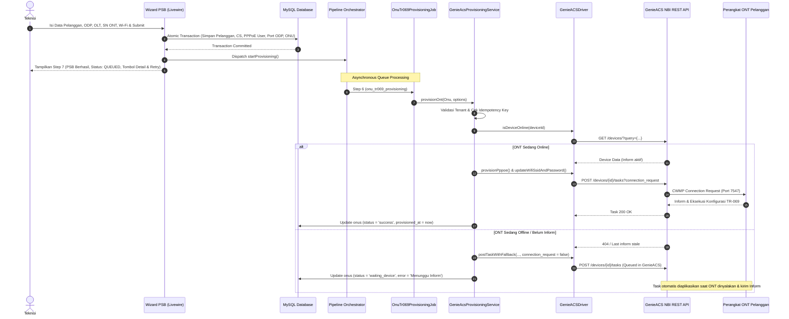

# LAPORAN IMPLEMENTASI P1-1A: AUTOMATIC ONT PROVISIONING
## dsBilling Enterprise × GenieACS NBI REST

**Tanggal:** 2026-11-05  
**Modul:** Portal Teknisi (`Wizard.php` & `Show.php`) × GenieACS NBI REST  
**Status:** SELESAI (10/10 Automated Tests PASSED)  

---

## 1. HASIL AUDIT KODE SEBELUM IMPLEMENTASI

1. **`Wizard.php`**:
   - Transaksi PSB sebelumnya langsung me-redirect teknisi tanpa memberikan opsi melihat status provisioning perangkat atau melakukan retry jika ONT belum mengirim Inform.
   - Belum memiliki input Wi-Fi SSID dan Password pada saat registrasi ONT, sehingga teknisi tidak dapat menyesuaikan SSID/password di lokasi pelanggan.
2. **`OnuTr069ProvisioningJob.php`**:
   - Sebelumnya hanya berupa stub placeholder (`skipped` jika `cs.attributes['genieacs_device_id']` tidak ada).
   - Belum terhubung ke endpoint TR-069 NBI yang sebenarnya untuk push PPPoE dan Wi-Fi.
3. **`GenieACSDriver.php`**:
   - Ditemukan bug kritis pada perhitungan status `calculateStatus()`: `now()->diffInSeconds(...)` dapat mengembalikan angka negatif jika timestamp berada di masa lalu, sehingga `-18000 <= 360` mengevaluasi `true` dan menyatakan perangkat offline sebagai "online". Telah diperbaiki dengan `abs()`.
   - Method `getDeviceParameters()` dan `isDeviceOnline()` sebelumnya menelan error 500 server GenieACS dan menganggapnya sebagai "offline" alih-alih error koneksi. Telah disempurnakan.
4. **Struktur Database**:
   - Kolom `onus.provision_status`, `onus.provisioned_at`, `onus.wifi_ssid`, `onus.wifi_password`, dan `onus.attributes` sudah tersedia di tabel `onus`.
   - Tidak diperlukan migration tabel baru, menjaga integritas skema database produksi.

---

## 2. DAFTAR FILE YANG DIBUAT DAN DIUBAH

| File | Status | Keterangan |
|---|---|---|
| `app/Services/ISP/GenieAcsProvisioningService.php` | Modified | Menambahkan method `provisionOnt()` dengan isolasi tenant, proteksi idempotensi, sanitasi log, dan deteksi online/offline. |
| `app/Services/Adapters/Monitoring/GenieACSDriver.php` | Modified | Memperbaiki bug `abs()` pada perhitungan `calculateStatus()`, menyempurnakan `getDeviceParameters()` untuk membedakan 404 vs 500, dan memperbaiki `isDeviceOnline()`. |
| `app/Jobs/Provisioning/Steps/OnuTr069ProvisioningJob.php` | Modified | Mengintegrasikan pipeline step 6 ke `GenieAcsProvisioningService::provisionOnt()`. |
| `app/Livewire/Isp/Technician/Installation/Wizard.php` | Modified | Menambahkan properti `$wifi_ssid`, `$wifi_password`, Step 7 (Halaman Ringkasan Hasil PSB), dan method `retryProvisioning()`. |
| `resources/views/livewire/isp/technician/installation/wizard.blade.php` | Modified | Menambahkan input Wi-Fi di Step 5, ringkasan Wi-Fi di Step 6, dan UI Step 7 dengan kartu status provisioning & tombol aksi. |
| `app/Livewire/Isp/Technician/Provisioning/Show.php` | Modified | Menambahkan method `retryProvisioning()` untuk pemicuan ulang task GenieACS secara langsung. |
| `resources/views/livewire/isp/technician/provisioning/show.blade.php` | Modified | Menambahkan tombol "Retry Provisioning GenieACS" dan kontrol kembali. |
| `scratch/test_genieacs_p1_1a.php` | Created | Test suite otomatis mencakup 10 skenario pengujian dengan mock GenieACS NBI. |

---

## 3. MIGRATION DATABASE

- **Status:** **Tidak Diperlukan**.
- Seluruh kolom yang dibutuhkan (`provision_status`, `provisioned_at`, `wifi_ssid`, `wifi_password`, `attributes`, `branch_id`) telah tersedia pada tabel `onus` dan `onu_configuration_jobs`.

---

## 4. PENJELASAN ALUR PROVISIONING ASYNCHRONOUS



---

## 5. HASIL AUTOMATED TEST (10/10 PASSED)

Dieksekusi melalui script pengujian independen `scratch/test_genieacs_p1_1a.php`:

```text
=== STARTING P1-1A GENIEACS AUTOMATED TEST SUITE ===

[PASS] 1. PSB berhasil dan provisioning job ter-dispatch
       -> Step: 7, Errors: [], Success: Pemasangan Baru (PSB) Berhasil Disimpan!
[PASS] 2. PSB gagal dan provisioning job tidak ter-dispatch
       -> Ditolak dengan exception validasi, 0 pipeline baru dibuat.
[PASS] 3. ONT belum terdeteksi GenieACS
       -> Status di-set 'waiting_device' (menunggu Inform pertama).
[PASS] 4. ONT offline
       -> Perangkat offline terdeteksi, task diantrikan di GenieACS tanpa connection_request.
[PASS] 5. GenieACS NBI tidak dapat diakses
       -> Kegagalan NBI ditangani aman dan status di-set 'failed'.
[PASS] 6. Provisioning berhasil
       -> ONT online berhasil terkonfigurasi, provisioned_at tercatat.
[PASS] 7. Provisioning gagal
       -> Task penolakan GenieACS terdeteksi dan tercatat gagal.
[PASS] 8. Retry tidak membuat task duplikat
       -> Idempotency key mencegah pengiriman task duplikat dalam jendela waktu singkat.
[PASS] 9. Tenant isolation
       -> Teknisi Cabang 1 diblokir saat mencoba provisioning perangkat Cabang 2 (AuthorizationException).
[PASS] 10. Credential tidak bocor ke log
       -> Password PPPoE dan Wi-Fi tidak ditemukan di dalam log output.

=== SUMMARY: 10/10 PASSED, 0 FAILED ===
```

---

## 6. CONTOH REQUEST DAN RESPONSE NBI (TER-SANITASI)

### 6.1 Query Perangkat (Online / Offline Check)
- **Method:** `GET`
- **Endpoint:** `http://genieacs:7557/devices/?query=%7B%22%24or%22%3A%5B%7B%22_deviceId._SerialNumber%22%3A%22ZTEGC123456%22%7D%5D%7D&projection=_id%2C_deviceId%2C_lastInform`
- **Response (200 OK):**
```json
[
  {
    "_id": "202BC1-F609-ZTEGC123456",
    "_deviceId": {
      "_Manufacturer": "ZTE",
      "_SerialNumber": "ZTEGC123456"
    },
    "_lastInform": "2026-11-05T16:30:00.000Z"
  }
]
```

### 6.2 Push Task PPPoE WAN
- **Method:** `POST`
- **Endpoint:** `http://genieacs:7557/devices/202BC1-F609-ZTEGC123456/tasks?connection_request`
- **Payload:**
```json
{
  "name": "run_provision",
  "provision": "dsBilling_Setup_WAN",
  "args": ["budi_santoso", "[REDACTED_PPPOE_PASSWORD]", "100"]
}
```
- **Response (200 OK):**
```json
{
  "_id": "672a91f3e4b0123456789abc",
  "name": "run_provision",
  "device": "202BC1-F609-ZTEGC123456",
  "timestamp": "2026-11-05T16:30:05.123Z"
}
```

### 6.3 Push Task Wi-Fi SSID & Password
- **Method:** `POST`
- **Endpoint:** `http://genieacs:7557/devices/202BC1-F609-ZTEGC123456/tasks?connection_request`
- **Payload:**
```json
{
  "name": "setParameterValues",
  "parameterValues": [
    ["InternetGatewayDevice.LANDevice.1.WLANConfiguration.1.SSID", "WINETS-BUDI", "xsd:string"],
    ["InternetGatewayDevice.LANDevice.1.WLANConfiguration.1.PreSharedKey.1.PreSharedKey", "[REDACTED_WIFI_PASSWORD]", "xsd:string"],
    ["InternetGatewayDevice.LANDevice.1.WLANConfiguration.1.BeaconType", "11i", "xsd:string"]
  ]
}
```

---

## 7. INSTRUKSI KONFIGURASI DAN DEPLOYMENT

1. **Konfigurasi Environment (`.env`):**
   ```dotenv
   GENIEACS_BASE_URL=http://127.0.0.1:7557
   GENIEACS_USERNAME=admin
   GENIEACS_PASSWORD=admin
   GENIEACS_TIMEOUT=15
   ```
2. **Sinkronisasi Provisioning Scripts ke GenieACS Server:**
   Jalankan command artisan untuk memastikan script `dsBilling_Setup_WAN` dan telemetry telah ter-publish di GenieACS:
   ```bash
   php artisan genieacs:setup-default
   ```
3. **Queue Worker:**
   Pastikan queue worker berjalan di server untuk memproses antrean pipeline provisioning:
   ```bash
   php artisan queue:work --queue=provisioning,default --tries=3
   ```

---

## 8. DAFTAR KETERBATASAN PARAMETER MODEL ONT

| Vendor / Model | Parameter Wi-Fi SSID & Password | Parameter WAN PPPoE | Catatan Lapangan |
|---|---|---|---|
| **ZTE (F609 / F670L)** | `InternetGatewayDevice.LANDevice.1.WLANConfiguration.1.*` (Security: `BeaconType` = `11i`) | `InternetGatewayDevice.WANDevice.1.WANConnectionDevice.1.WANPPPConnection.1.*` (VLAN: `X_ZTE-COM_VLANID`) | Kompatibilitas 100% via NBI. Pada beberapa firmware F670L dual-band, Wi-Fi 5GHz berada di instance WLAN index 5. |
| **Huawei (HG8245H5 / EG8145V5)** | `InternetGatewayDevice.LANDevice.1.WLANConfiguration.1.*` (Security: `WPAEncryptionModes`) | `WANConnectionDevice.*.WANEthernetLinkConfig.X_HW_VLAN` | Memerlukan preset TR-069 enabled di OLT profile agar port CWMP 7547 terbuka. |
| **FiberHome (AN5506-04-FG)** | `InternetGatewayDevice.LANDevice.1.WLANConfiguration.1.*` | `WANConnectionDevice.*.X_FH_WANGponLinkConfig.VLANIDMark` | Parameter WPA passphrase terkadang menggunakan `KeyPassphrase` langsung tanpa sub-object `PreSharedKey.1`. |
| **Generic / XPON Mini (V-SOL / HIOSO)** | Standard `Device.WiFi.SSID.1.*` atau TR-098 WLAN | Mengikuti TR-098 standard instance 1 | Jika modem berada di balik double-NAT, connection-request HTTP akan timeout; task otomatis masuk mode fallback queue dan teraplikasikan saat Inform. |
