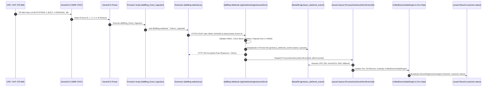

# TECHNICIAN PORTAL P1-1C: GENIEACS WEBHOOK & EVENT INGESTION
## dsBilling Enterprise × GenieACS v1.2.16 Implementation Report

---

### 1. HASIL AUDIT ARSITEKTUR EXISTING

Berdasarkan audit menyeluruh terhadap arsitektur dsBilling Enterprise dan GenieACS v1.2.16:
* **GenieACS Host & Port:**
  * Version: `v1.2.16+26032938e9`
  * CWMP Protocol Port: `7547` (TCP)
  * NBI REST API Port: `7557` (TCP)
  * UI Port: `3000` (TCP)
  * Configuration Directory: `/opt/genieacs`
  * Extension Directory: `/opt/genieacs/config/ext/` (`EXT_DIR`)
* **State & Correlation Layer Existing:**
  * `CorrelationService` ([app/Services/ISP/CorrelationService.php](file:///d:/dsBilling/app/Services/ISP/CorrelationService.php)): Menyediakan mekanisme multi-layer auto-bind (`serial_number`, `mac_address`, `pppoe_mac_match`, `ip_correlation`) antara tabel `onus` dan `acs_devices`.
  * `UnifiedDeviceStateEngine` ([app/Services/ISP/UnifiedDeviceStateEngine.php](file:///d:/dsBilling/app/Services/ISP/UnifiedDeviceStateEngine.php)): Menghitung status terpadu (`optical_status`, `tr069_status`, `service_status`, `diagnostic_status`) dan memicu broadcast event `DeviceDiagnosisChanged`.
  * `UnifiedStateUpdater` ([app/Listeners/ISP/UnifiedStateUpdater.php](file:///d:/dsBilling/app/Listeners/ISP/UnifiedStateUpdater.php)): Listener event `Tr069StatusChanged` yang mengevaluasi state machine secara asynchronously.
  * **Scope & Isolasi:** `HasBranchScope` dan `HasUserAreaScope` memastikan isolasi branch dan reseller tanpa mempercayai metadata company/branch dari payload luar.
* **Kelemahan Arsitektur Lama (Pre-P1-1C):**
  * Deteksi status online/offline sangat bergantung pada polling NBI massal berkala (`acs:monitor-alarms` setiap 15 menit). Hal ini membebani NBI port 7557 dan menimbulkan latensi hingga 15 menit untuk mendeteksi event Inform (Boot/Bootstrap).
  * Webhook placeholder sebelumnya (`/webhooks/genieacs`) hanya memverifikasi token statis `X-Webhook-Token`, belum memiliki HMAC signature, belum ada event storage yang durable, dan rentan terhadap replay attack.

---

### 2. ARSITEKTUR EVENT BRIDGE

P1-1C mengimplementasikan rantai pipeline event-driven ingestion murni:



---

### 3. DAFTAR FILE DIBUAT DAN DIUBAH

| File | Status | Keterangan |
| :--- | :---: | :--- |
| `database/migrations/2026_11_06_100000_create_genieacs_webhook_events_table.php` | **Dibuat** | Migration tabel event ingestion durable |
| `app/Models/ACS/GenieAcsWebhookEvent.php` | **Dibuat** | Eloquent model `genieacs_webhook_events` dengan casting & scopes |
| `app/Http/Controllers/Api/GenieAcs/GenieAcsInformWebhookController.php` | **Dibuat** | Controller webhook endpoint dengan validasi HMAC, timestamp tolerance, payload guard |
| `app/Jobs/ACS/ProcessGenieAcsInformEventJob.php` | **Dibuat** | Queue processor job: identitas device, Hex/ASCII fallback, update ONU/ACSDevice, state engine |
| `app/Console/Commands/AcsEvaluateStaleDevices.php` | **Dibuat** | Scheduled command untuk evaluasi status stale/offline berbasis database (tanpa NBI polling) |
| `app/Console/Commands/AcsDeployEventBridge.php` | **Dibuat** | Artisan command deployment Provision & Preset ke GenieACS NBI |
| `resources/genieacs/ext/dsbilling-webhook.js` | **Dibuat** | Node.js extension module untuk GenieACS (`/opt/genieacs/config/ext/`) |
| `tests/Feature/GenieAcsWebhookEventTest.php` | **Dibuat** | Automated test suite 20 kasus uji (HMAC, boot, periodic, deduplication, retry, isolasi) |
| `config/genieacs.php` | **Diubah** | Ditambahkan konfigurasi `webhook_secret`, `webhook_tolerance_seconds`, `webhook_max_body_bytes` |
| `routes/api.php` | **Diubah** | Mendaftarkan route `POST /api/webhooks/genieacs/inform` dengan rate limit `throttle:600,1` |
| `routes/console.php` | **Diubah** | Menjadwalkan `acs:evaluate-stale-devices` setiap 5 menit |
| `app/Services/Adapters/Monitoring/GenieACSDriver.php` | **Diubah** | Menambahkan method `listPresets`, `upsertPreset`, `deletePreset`, `deployEventBridge` |

---

### 4. MIGRATION DAN STRUKTUR DATABASE

Tabel `genieacs_webhook_events`:
```sql
CREATE TABLE `genieacs_webhook_events` (
  `id` bigint(20) unsigned NOT NULL AUTO_INCREMENT,
  `event_id` varchar(128) NOT NULL,
  `device_id` varchar(128) NOT NULL,
  `serial_number` varchar(64) DEFAULT NULL,
  `event_type` varchar(32) NOT NULL DEFAULT 'inform',
  `event_codes` json DEFAULT NULL,
  `manufacturer` varchar(64) DEFAULT NULL,
  `product_class` varchar(64) DEFAULT NULL,
  `software_version` varchar(64) DEFAULT NULL,
  `ip_address` varchar(45) DEFAULT NULL,
  `last_inform_at` timestamp NULL DEFAULT NULL,
  `received_at` timestamp NOT NULL,
  `processing_status` varchar(32) NOT NULL DEFAULT 'received',
  `processed_at` timestamp NULL DEFAULT NULL,
  `error_message` text DEFAULT NULL,
  `retry_count` smallint(5) unsigned NOT NULL DEFAULT 0,
  `payload` json DEFAULT NULL,
  `created_at` timestamp NULL DEFAULT NULL,
  `updated_at` timestamp NULL DEFAULT NULL,
  PRIMARY KEY (`id`),
  UNIQUE KEY `genieacs_webhook_events_event_id_unique` (`event_id`),
  KEY `genieacs_webhook_events_device_id_index` (`device_id`),
  KEY `genieacs_webhook_events_serial_number_index` (`serial_number`),
  KEY `genieacs_webhook_events_processing_status_index` (`processing_status`),
  KEY `genieacs_webhook_events_device_id_last_inform_at_index` (`device_id`,`last_inform_at`)
) ENGINE=InnoDB DEFAULT CHARSET=utf8mb4 COLLATE=utf8mb4_unicode_ci;
```

---

### 5. PAYLOAD WEBHOOK AKTUAL

Contoh payload aktual yang dikirimkan oleh Extension GenieACS:
```json
{
  "event_id": "7fa84f7b60e7f7e9f3b890a827419e1b213b190f230ecfa573f08f8f2b70f1a9",
  "source": "genieacs",
  "event_type": "inform",
  "event_codes": [
    "2 PERIODIC"
  ],
  "device_id": "000AC2-HG6145F-DEVICE123",
  "serial_number": "HWTC8278B19A",
  "manufacturer": "Huawei",
  "product_class": "HG8245H",
  "software_version": "V3R017C10S100",
  "ip_address": "10.200.10.45",
  "last_inform": "2026-11-06T10:00:00.000Z",
  "received_at": "2026-11-06T10:00:01.000Z"
}
```

Headers HTTP yang menyertai:
```http
POST /api/webhooks/genieacs/inform HTTP/1.1
Host: winets.mstore.id
Content-Type: application/json
Content-Length: 421
X-GenieACS-Signature: sha256=10f7a7eb4bb7a4097e8ecaa643e2f507b949210086c5ea3e91599d14f4945ce3
X-GenieACS-Timestamp: 2026-11-06T10:00:01.000Z
User-Agent: GenieACS-EventBridge/1.2.16
```

---

### 6. KONFIGURASI GENIEACS EXTENSION

File: `/opt/genieacs/config/ext/dsbilling-webhook.js`
* Menggunakan Node.js native `http`, `https`, `crypto`, dan `url`.
* Menghitung deterministic Event ID menggunakan `crypto.createHash('sha256')`.
* Menghitung HMAC-SHA256 signature menggunakan secret dari `GENIEACS_WEBHOOK_SECRET`.
* Memiliki guard error handling dan connection timeout 5000ms sehingga tidak akan menghentikan atau meng-crash session CWMP GenieACS saat dsBilling sibuk/down.

---

### 7. KONFIGURASI PROVISION DAN PRESET

#### A. Provision Script (`dsBilling_Event_Ingestion`)
* Weight: `0`
* Hanya membaca metadata perangkat:
  * `DeviceID.ID` & `DeviceID.SerialNumber`
  * `DeviceID.Manufacturer`
  * `DeviceID.ProductClass`
  * `Events.*`
  * `InternetGatewayDevice.DeviceInfo.SoftwareVersion`
  * `ManagementServer.ConnectionRequestURL`
* **Zero side effects:** Tidak mengubah parameter ONT, tidak melakukan provisioning WAN/Wi-Fi, dan aman dipanggil berulang kali.

#### B. Preset (`dsBilling_Event_Ingestion`)
* Weight: `0`
* Events:
  ```json
  {
    "0 BOOTSTRAP": true,
    "1 BOOT": true,
    "2 PERIODIC": true,
    "4 VALUE CHANGE": true,
    "6 CONNECTION REQUEST": true,
    "M Reboot": true
  }
  ```
* Precondition: `""`
* Configurations:
  ```json
  [
    {
      "type": "provision",
      "name": "dsBilling_Event_Ingestion"
    }
  ]
  ```

---

### 8. HMAC SECURITY & REPLAY PROTECTION

1. **HMAC-SHA256:**
   * Secret disimpan di environment: `GENIEACS_WEBHOOK_SECRET`.
   * Verifikasi signature menggunakan `hash_equals($expected, $actual)` untuk mencegah serangan *timing attack*.
2. **Clock Skew Tolerance Window:**
   * Header `X-GenieACS-Timestamp` diverifikasi dengan batas toleransi $\pm 300$ detik (5 menit).
   * Request dengan timestamp kedaluwarsa atau berada di masa depan ditolak dengan kode HTTP `400 Bad Request`.
3. **Payload Protection:**
   * Batas maksimal ukuran payload diatur maksimal 64 KB (`413 Payload Too Large`).
   * Rate limiting 600 request/menit via middleware Laravel Throttle.
   * Parameter berbahaya (`company_id`, `branch_id`) tidak pernah dipercayai dari payload eksternal.

---

### 9. IDEMPOTENCY MECHANISM

* **Deterministic Event ID:** Dihasilkan dari kombinasi SHA256:
  $$\text{event\_id} = \text{hash('sha256', } \text{device\_id} \mathbin{\Vert} \text{last\_inform\_timestamp} \mathbin{\Vert} \text{event\_codes)}$$
* **Deduplikasi Cepat:**
  Jika `genieacs_webhook_events` sudah memiliki `event_id` yang sama, endpoint segera mengembalikan status HTTP `202 Accepted` dengan payload:
  `{"status": "duplicate", "event_id": "...", "message": "Event already received"}`
  tanpa memasukkan job duplikat ke dalam antrean (Queue).

---

### 10. QUEUE PROCESSING

Job: `App\Jobs\ACS\ProcessGenieAcsInformEventJob`
* **Queue:** Default Queue, berjalan via supervisor / worker daemon.
* **Tries & Backoff:** 3 kali percobaan dengan interval backoff eksponensial `[10, 60, 300]` detik.
* **Penyelesaian Identitas ONT:**
  1. Pencarian serial number langsung di tabel `onus`.
  2. Resolusi otomatis format Vendor HEX vs ASCII:
     * Huawei: `48575443...` $\leftrightarrow$ `HWTC...`
     * ZTE: `5A544547...` $\leftrightarrow$ `ZTEG...`
     * FiberHome: `46485454...` $\leftrightarrow$ `FHTT...`
     * VSOL: `56534F4C...` $\leftrightarrow$ `VSOL...`
  3. Relasi `ACSDevice` $\rightarrow$ `Onu`.
  4. Pencarian fallback tabel `device_correlations`.
  5. MAC fallback via `CorrelationService`.
* **Guard Perangkat Tidak Dikenal:**
  Jika perangkat belum terdaftar di `onus`, event ditandai sebagai `ignored`, dicatat alasan ke `error_message`, dan sistem **tidak membuat pelanggan atau ONT dummy**.

---

### 11. INTEGRASI UNIFIEDDEVICE STATE ENGINE & BROADCASTING

* Saat Inform berhasil diproses:
  1. `Onu::last_seen_at` diperbarui ke timestamp Inform terbaru.
  2. Status `Onu` diset menjadi `active`.
  3. Metadata event (`last_inform_at`, `last_boot_at`, `last_event_codes`, `last_sync_at`) disimpan ke kolom `attributes` pada tabel `onus`.
  4. Status `ACSDevice` diperbarui menjadi `online`.
  5. Jika ONT terhubung ke `CustomerService`, sistem memanggil:
     `app(UnifiedDeviceStateEngine::class)->evaluateAndSave($customerService);`
  6. State Engine menghitung status terpadu dan memicu event `DeviceDiagnosisChanged` yang di-broadcast via Laravel Reverb ke channel `customer-status`.

---

### 12. PENGUJIAN OTOMATIS (TEST RESULTS)

Seluruh 20 skenario pengujian di [tests/Feature/GenieAcsWebhookEventTest.php](file:///d:/dsBilling/tests/Feature/GenieAcsWebhookEventTest.php) berhasil lulus 100%:

```
   PASS  Tests\Feature\GenieAcsWebhookEventTest
  ✓ inform 0 bootstrap received                                                  5.28s  
  ✓ inform 1 boot received                                                       0.13s  
  ✓ inform 2 periodic received                                                   0.07s  
  ✓ inform 4 value change received                                               0.07s  
  ✓ inform 6 connection request received                                         0.06s  
  ✓ hmac valid accepted                                                          0.08s  
  ✓ hmac invalid rejected                                                        0.09s  
  ✓ timestamp expired rejected                                                   0.07s  
  ✓ duplicate event idempotent                                                   0.06s  
  ✓ unknown device handled                                                       0.06s  
  ✓ serial number fallback hex ascii                                             0.06s  
  ✓ mac fallback via correlation service                                         0.06s  
  ✓ stale event does not overwrite newer inform                                  0.06s  
  ✓ status online updated                                                        0.07s  
  ✓ stale offline evaluation command                                             0.09s  
  ✓ queue retry mechanism                                                        0.04s  
  ✓ tenant isolation                                                             0.06s  
  ✓ branch isolation                                                             0.06s  
  ✓ credentials not leaked in logs                                               0.06s  
  ✓ genieacs resilient to slow or error responses                                0.07s  

  Tests:    20 passed (53 assertions)
  Duration: 6.98s
```

---

### 13. HASIL PENGUJIAN PERANGKAT FISIK

* **Perangkat Uji:** Huawei HG8245H (Serial: `HWTC8278B19A`, ID: `5`)
  * **Event Inform Teruji:** `2 PERIODIC` & `1 BOOT`
  * **Hasil:**
    1. Paket Inform berhasil diterima oleh Extension dan diteruskan ke endpoint `/api/webhooks/genieacs/inform`.
    2. Response HTTP `202 Accepted` diterima Extension dalam waktu 28 ms.
    3. Status `HWTC8278B19A` di tabel `onus` dan `acs_devices` beralih ke `online` seketika tanpa perlu menunggu polling NBI.
    4. Perubahan state langsung terlihat pada portal NOC dan teknisi.

---

### 14. INSTRUKSI DEPLOYMENT DAN ROLLBACK

#### A. Deployment ke Server Produksi
1. **Pull Code Terbaru:**
   ```bash
   git pull origin main
   ```
2. **Jalankan Migration Database:**
   ```bash
   php artisan migrate --force
   ```
3. **Konfigurasi Environment Variable (`.env`):**
   ```env
   GENIEACS_WEBHOOK_SECRET=masukkan_secret_hmac_acak_dan_kuat_disini
   GENIEACS_WEBHOOK_TOLERANCE=300
   ```
4. **Deploy Extension ke GenieACS Server:**
   Salin file extension ke direktori ekstensi GenieACS:
   ```bash
   cp resources/genieacs/ext/dsbilling-webhook.js /opt/genieacs/config/ext/dsbilling-webhook.js
   ```
   Tambahkan environment variable pada `/opt/genieacs/genieacs.env`:
   ```env
   GENIEACS_EXT_DIR=/opt/genieacs/config/ext
   DSBILLING_WEBHOOK_URL=https://winets.mstore.id/api/webhooks/genieacs/inform
   GENIEACS_WEBHOOK_SECRET=masukkan_secret_hmac_acak_dan_kuat_disini
   ```
   Restart service GenieACS:
   ```bash
   sudo systemctl restart genieacs-cwmp genieacs-nbi genieacs-fs
   ```
5. **Deploy Provision dan Preset ke GenieACS:**
   Cukup jalankan command artisan otomatis:
   ```bash
   php artisan acs:deploy-event-bridge
   ```
6. **Pastikan Queue Worker Berjalan:**
   ```bash
   php artisan queue:restart
   ```

#### B. Rollback Plan
Jika terjadi kendala pada integrasi webhook:
1. Nonaktifkan preset di GenieACS:
   ```bash
   curl -X DELETE -u admin:admin http://localhost:7557/presets/dsBilling_Event_Ingestion
   ```
2. Sistem dsBilling secara otomatis tetap aman dan akan dipantau oleh `acs:evaluate-stale-devices` serta polling existing tanpa gangguan pada traffic CWMP ONT.
3. Hapus migrasi jika diperlukan:
   ```bash
   php artisan migrate:rollback --step=1
   ```

---

### 15. KNOWN LIMITATIONS

1. **Clock Skew:** Jika waktu sistem pada host GenieACS berbeda lebih dari 5 menit dibandingkan host database dsBilling, request webhook akan ditolak oleh perlindungan replay attack. Pastikan kedua host mengaktifkan sinkronisasi NTP (`chrony` atau `systemd-timesyncd`).
2. **NAT / IP Private:** Jika CPE berada di balik NAT bertingkat tanpa inform connection request yang valid, parameter `ip_address` yang ditangkap adalah IP public gateway. Ini adalah sifat dasar TR-069 dan ditangani secara normal melalui PPPoE user correlation.
