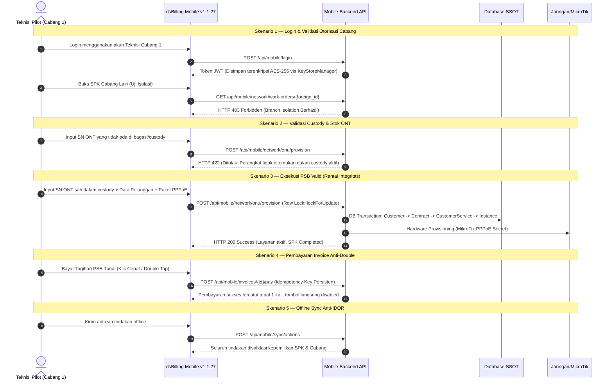

# RUNBOOK DEPLOYMENT TAHAP 1 — PILOT BRANCH ROLLOUT
## dsBilling Enterprise & dsBilling Mobile v1.1.27 Build 10127

---

## 1. PROFIL DEPLOYMENT PILOT

| Parameter | Spesifikasi Pilot |
| :--- | :--- |
| **Cabang Pilot Target** | **Cabang 1 (Kode: CB1, ID: 2)** |
| **Cabang Kontrol Alternatif** | Kantor Pusat (PST, ID: 1) / Branch Recovery (BR-REC, ID: 3) |
| **Target Pengguna** | Tim Teknisi Lapangan Terpilih Cabang 1 (Misal: User ID 3, 21) |
| **Versi Mobile** | **dsBilling Mobile v1.1.27 (Build 10127)** |
| **File Rilis APK** | `app-release.apk` |
| **Lokasi File APK** | `D:\dsbilling-mobile\app\build\outputs\apk\release\app-release.apk` |
| **Ukuran File APK** | **10.465.138 byte** |
| **SHA256 Checksum** | `91B799FA5C647C1EFA6088DD3148B9D9E0037EF58136420B81AE0D62CD89FD84` |
| **Tanda Tangan Digital** | APK Signature Scheme v1 & v2 (Release Keystore) |
| **Target Backend URL** | `https://mstore.mstore.id` (Produksi/Pilot Server) |
| **Basis Data SSOT** | MySQL / SQLite Enterprise (Integritas PSB Phase 1B aktif) |

---

## 2. CHECKLIST PERSIAPAN BACKEND (PRE-DEPLOYMENT)

Lakukan verifikasi berikut pada server backend sebelum mendistribusikan APK:

### 2.1 Verifikasi Status Migrasi Database
Pastikan seluruh 50 batch migrasi telah berstatus `Ran`:
```bash
php artisan migrate:status
```
*Khususnya pastikan migrasi pengaman idempotensi Phase 1A aktif:*
- `2026_11_25_090000_add_unique_constraints_to_payments_and_material_usages`

### 2.2 Optimasi Cache Aplikasi
Segarkan cache konfigurasi, routing, dan view agar seluruh pengaman baru Phase 1B.1 aktif:
```bash
php artisan config:clear
php artisan route:clear
php artisan view:clear

php artisan config:cache
php artisan route:cache
php artisan view:cache
```

### 2.3 Monitoring Log Realtime
Buka terminal monitoring pada server untuk memantau request dari cabang pilot secara langsung:
```bash
tail -f storage/logs/laravel.log | grep -E "ProvisioningService|MobileNetwork|MobileSync|AuditLog"
```

---

## 3. PROSEDUR DISTRIBUSI APK KEPADA TEKNISI PILOT

### 3.1 Verifikasi Integritas File APK
Sebelum dikirimkan ke perangkat teknisi pilot, verifikasi kecocokan checksum SHA256:
```powershell
Get-FileHash -Algorithm SHA256 "D:\dsbilling-mobile\app\build\outputs\apk\release\app-release.apk"
# Hash wajib: 91B799FA5C647C1EFA6088DD3148B9D9E0037EF58136420B81AE0D62CD89FD84
```

### 3.2 Langkah Instalasi pada Perangkat Android Teknisi
1. **Transfer File:** Kirim `app-release.apk` ke smartphone Android teknisi pilot (via secure direct transfer / Google Drive internal).
2. **Izin Sideload:** Aktifkan *"Install unknown apps"* pada browser/file manager teknisi.
3. **Instalasi / Update:** Pasang `app-release.apk`. Aplikasi akan memperbarui versi sebelumnya tanpa menghapus session cache lokal.
4. **Verifikasi Izin Aplikasi:**
   - **Kamera:** Wajib diizinkan (untuk pemindaian barcode/QR serial number ONT).
   - **Lokasi (GPS):** Wajib diizinkan (*Precise Location*) untuk validasi koordinat pemasangan dan pemetaan ODP.
5. **Verifikasi Versi di Aplikasi:**
   - Buka menu **Profil / Pengaturan**.
   - Pastikan teks versi menampilkan: `v1.1.27 (Build 10127)`.

---

## 4. SKENARIO PENGUJIAN OPERASIONAL CABANG PILOT

Jalankan 5 skenario verifikasi berurutan bersama teknisi cabang pilot:



### Skenario 1: Login & Validasi Isolasi Cabang
- Teknisi login ke aplikasi mobile.
- Pastikan token sesi tersimpan di Android Keystore.
- Buka daftar SPK: pastikan teknisi **hanya melihat SPK milik Cabang 1**.
- Coba akses URL/ID SPK cabang lain secara langsung: sistem wajib merespons `HTTP 403 Forbidden`.

### Skenario 2: Validasi Custody Inventaris ONT
- Coba selesaikan pemasangan menggunakan serial number ONT yang **belum dimutasi** ke bagasi teknisi.
- Hasil yang diharapkan: Aplikasi menampilkan pesan penolakan: *"Aktivasi PSB ditolak: Perangkat ONT tidak ditemukan dalam custody/bagasi aktif Anda"* (`HTTP 422`).

### Skenario 3: Penyelesaian PSB Utuh (Rantai Integritas SSOT)
- Teknisi menyelesaikan 1 SPK pemasangan riil di Cabang 1 menggunakan serial ONT sah di bagasinya.
- Periksa di dashboard Web dsBilling:
  1. Data `Customer` terbentuk dengan kode pelanggan unik dan `branch_id = 2`.
  2. Data `Contract` aktif terhubung ke pelanggan.
  3. Data `CustomerService` terhubung ke `ServiceProfile` yang dipilih (tidak null/kosong).
  4. Data `ServiceInstance` dan `ProvisionPipeline` terhubung sempurna.
  5. Secret PPPoE terbuat di MikroTik Cabang 1.
  6. SPK berstatus `completed` dan mutasi stok berkurang 1 unit ONT secara akurat.

### Skenario 4: Pembayaran Invoice Tunai Anti Double Payment
- Buka invoice pemasangan/tagihan pertama di aplikasi mobile.
- Tekan tombol **Bayar Tunai** secara cepat berulang kali (*double tap simulation*).
- Hasil yang diharapkan:
  - Tombol bayar langsung nonaktif (*disabled*) seketika pada sentuhan pertama.
  - Request membawa header `X-Idempotency-Key` persisten.
  - Pembayaran dan jurnal keuangan tercatat tepat 1 kali tanpa duplikasi saldo.

### Skenario 5: Offline Sync Anti-IDOR
- Masuk ke mode offline (Airplane mode) dan simpan checklist pekerjaan.
- Aktifkan koneksi kembali dan lakukan sinkronisasi offline.
- Periksa log backend: endpoint `MobileSyncApiController` memvalidasi kepemilikan SPK, company, dan branch.

---

## 5. RENCANA MITIGASI & PROTOKOL ROLLBACK DARURAT

Jika selama masa uji coba pilot ditemukan anomali kritis:

| Indikator Anomali | Ambang Batas Toleransi | Tindakan Mitigasi |
| :--- | :---: | :--- |
| **Tingkat Error API (HTTP 500)** | > 0,5% dari total request | Investigasi `storage/logs/laravel.log`, perbaiki hotfix tanpa rollback database |
| **Duplikasi Transaksi / Kas** | **0 kasus** (Toleransi Nol) | Nonaktifkan endpoint pembayaran mobile sementara via config, periksa `payments` table |
| **Gagal Provisioning Hardware** | > 5% akibat timeout | Cek latency jaringan OLT/MikroTik, SPK tetap berstatus `in_progress` secara aman |

### Prosedur Rollback Aplikasi Mobile (Jika Diperlukan):
1. Jika rilis v1.1.27 Build 10127 mengalami kendala fatal di perangkat teknisi pilot, tim NOC dapat langsung membagikan APK versi stabil sebelumnya (`v1.1.26 Build 10126`).
2. Karena perbaikan backend Phase 1B bersifat *backward-compatible*, backend v1.1.27 tetap mendukung request dari aplikasi mobile versi lama.

---

## 6. KRITERIA KELULUSAN TAHAP 1 (EXIT CRITERIA)

Tahap 1 dinyatakan **SELESAI & LULUS** untuk melangkah ke **Tahap 2 (Eksekusi Checklist Staging Fisik)** apabila:
1. [x] APK Release v1.1.27 Build 10127 berhasil dipasang pada minimal 2 perangkat teknisi pilot Cabang 1.
2. [ ] Minimal 3 SPK pemasangan PSB berhasil diselesaikan di lapangan tanpa ada entitas layanan yang kosong atau terputus.
3. [ ] Tidak ada insiden duplikasi pembayaran tunai atau selisih mutasi stok material.
4. [ ] Seluruh log audit backend mencatat transaksi cabang pilot secara rapi tanpa unhandled exceptions.
